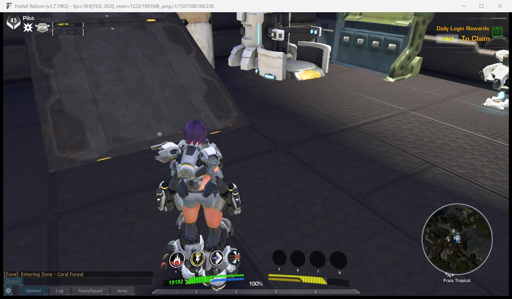

# Progress log

Newest first. Release date: TBA.

- **2026-11-16 19:19 (UTC+0)** - Started: Animations for everything (owner 2026-11-15: "make sure you add the animations for everything later"): NPC melee/attack

- **2026-11-16 19:05 (UTC+0)** - Own server fix: levelling up now raises your health properly. Before, your maximum went up but you stayed at your old health; now the extra health is yours straight away (an Assault goes from 576 at level 10 to 801 at level 12, following the game's own level table).

- **2026-11-16 18:59 (UTC+0)** - Own server update: two more creatures from the old fan wiki live near Praia Tropical now. A pair of Culex (flying insects with a ranged stinger) hover east of the beach, and a Skiver nest to the west: Skivers leap at you from mid range and spit acid. Both render fully textured with their real names, and the death screen tells you which one got you.

- **2026-11-16 18:50 (UTC+0)** - Own server update: Brontodons now throw boulders. The herd near Praia Tropical leaves you alone until you shoot one; then it throws a boulder from up to 20 m, charges you and sweeps with its tusks. (The plain Brontodon in the game data has no boulder, so the herd uses the Brontodon variant that does.)

- **2026-11-16 16:50 (UTC+0)** - Own server update: the XP pop-up now says KILL under the XP instead of 'unknown', and enemies show their real level on their health plates (it was 0). The Giant Aranha's acid now splashes where it lands instead of around the spider itself, and leaves you burning briefly: the game's own acid burn effect now ticks on the server (status effects with timed updates work in general now). Next: more creatures from the old fan wiki, the Brontodon's boulder throw, animations.

- **2026-11-16 12:14 (UTC+0)** - Done: Finest virtual-texture levels static.vtex0-2 (23 GB, streamed by the dead servers): the real files, shared by

- **2026-11-16 07:55 (UTC+0)** - Own server fix: creature path finding is smarter. Creatures now step down off ledges, no longer get stuck inside rocks, and when they can't reach you (you're up on a platform) they wait at the closest spot instead of wandering into caves underneath.

- **2026-11-16 07:47 (UTC+0)** - Own server update: three fixes. (1) Your health now comes from your battleframe, its gear and its level instead of a flat 1000 (a level 10 Assault has 576, it grows as you level). (2) The launcher no longer fails with 'could not create your account (500)' after the game was closed badly: it now waits until the database has finished starting. (3) Creatures find their way round rocks and buildings: when something blocks them they work out a path (A*) over the real world collision, e.g. Aranha Workers walked 60 m round the cliff and up the slope toward a player standing on a platform above them.

  ![Own server update: three fixes. (1) Your health now comes from your battleframe, its gear and its level instead of a flat 1000 (a level 10 Assault has 576, it grows as you level). (2) The launcher no longer fails with 'could not create your account (500)' after the game was closed badly: it now waits until the database has finished starting. (3) Creatures find their way round rocks and buildings: when something blocks them they work out a path (A*) over the real world collision, e.g. Aranha Workers walked 60 m round the cliff and up the slope toward a player standing on a platform above them.](images/progress/2026-11-16_074743_1.jpg)

- **2026-11-15 12:35 (UTC+0)** - Own server update: the world's creatures are the real ones now, fully textured: Aranha Workers that leap at you, a Giant Aranha that spits acid, and a herd of Brontodons that ignore you until you shoot one, then charge and knock you back. Their move sets come from the old Firefall fan wiki (rescued from the Internet Archive), since the original creature AI lived only on Red 5's servers. Next: enemy names on health bars and XP pop-ups, acid pools, more creatures.

- **2026-11-15 11:59 (UTC+0)** - Own server update: creatures fight like creatures now. Aranhas and other melee creatures use the game's own creature attacks: a bite with its attack animation (damage from the original level tables), and a pounce where they leap at you from up to 16 m away and land a hard hit. Next: more enemy moves (lunges, knock-back) and more animations.

- **2026-11-15 11:33 (UTC+0)** - Own server update: the supercharge meter is in. Damage you deal fills it (about 2% per hit on an Aranha), Shockwave needs a full bar and empties it, and the supercharge power-up fills it straight away. Abilities whose conditions aren't met are now refused properly instead of half-firing. Next: enemy special attacks.

- **2026-11-15 11:25 (UTC+0)** - Own server update: melee works. The swing plays its animation and hits the nearest enemy in front of you for the module's Melee Damage. With Meteor Strike, Overcharge and Shockwave already working, all four starter abilities now do their job. Next: the supercharge meter for Shockwave.

- **2026-11-15 11:21 (UTC+0)** - Own server update: Shockwave works. It charges, then sends its wave forward, and every enemy the wave touches takes the module's Shockwave Damage (tested: one wave killed an Aranha). Overcharge runs for its full time as well. Next: melee, and the supercharge meter that Shockwave needs (for now you can use it again straight away).

- **2026-11-15 11:16 (UTC+0)** - Own server update: boosts now really work. The damage power-up doubles the damage you deal, the armour power-up cuts the damage you take to a tenth (tested: Aranha bites went from 84 to 8 for the boost's 7 seconds), and Meteor Strike's leap gives its real damage protection. Overcharge's no-ammo effect is counted on the server too. Next: Overcharge, Shockwave and melee themselves.

- **2026-11-15 11:10 (UTC+0)** - Own server fix: enemy health bars now show as soon as you aim at an enemy, not only after your first hit. Still missing: enemy names and levels on those bars.

- **2026-11-15 10:58 (UTC+0)** - Own server update: the ability system has started. The server now runs the game's own ability scripts: health packs heal you, ammo packs refill your weapons, boost power-ups light up, and Meteor Strike's landing now damages every enemy in its blast radius (using the module's real Crater Damage and radius). Next: damage/armour boosts counted on the server, then Overcharge, Shockwave and melee.

- **2026-11-15 04:46 (UTC+0)** - Own server update: kills now give XP and loot. XP comes with the +XP pop-up, fills the XP bar and levels your battleframe up (saved to your character). Loot rolls from the game's own loot tables (checked for all 3109 enemy types): Crystite and items land in your inventory and stay there between sessions, and power-ups trigger on pickup. Next: the ability system (power-up heals and ammo, enemy special attacks, your own abilities).

- **2026-11-15 03:43 (UTC+0)** - Own server update: the world now has real collision (our own reader for the game's Havok collision data): enemies walk on terrain, floors and rocks, steer around obstacles, and walls and hills block shots both ways. Enemy camps are placed around Praia Tropical (Aranhas, Dark Ones, Chosen, beetles); they wake up when you come near and come back a couple of minutes after you clear them, with status messages in chat. Next: loot and XP, then animations.

  

- **2026-11-15 02:39 (UTC+0)** - Own server progress: combat works. Enemies from the game's own data can be spawned (soldiers, Aranhas, Brontodons) with their real models, names, factions and weapons. You can shoot them (weapon damage from game data, floating damage numbers) and they fight back: creatures close in and bite, soldiers keep their distance and fire at their weapon's rate. Enemy health and damage scale with level from the original level tables, and the death screen shows who killed you. Also fixed: Meteor Strike launch and impact, flashing energy bar, screen shake. Next: terrain and walls for enemies and shots, then animations.

  ![Own server progress: combat works. Enemies from the game's own data can be spawned (soldiers, Aranhas, Brontodons) with their real models, names, factions and weapons. You can shoot them (weapon damage from game data, floating damage numbers) and they fight back: creatures close in and bite, soldiers keep their distance and fire at their weapon's rate. Enemy health and damage scale with level from the original level tables, and the death screen shows who killed you. Also fixed: Meteor Strike launch and impact, flashing energy bar, screen shake. Next: terrain and walls for enemies and shots, then animations.](images/progress/2026-11-15_023911_1.jpg)

  ![Own server progress: combat works. Enemies from the game's own data can be spawned (soldiers, Aranhas, Brontodons) with their real models, names, factions and weapons. You can shoot them (weapon damage from game data, floating damage numbers) and they fight back: creatures close in and bite, soldiers keep their distance and fire at their weapon's rate. Enemy health and damage scale with level from the original level tables, and the death screen shows who killed you. Also fixed: Meteor Strike launch and impact, flashing energy bar, screen shake. Next: terrain and walls for enemies and shots, then animations.](images/progress/2026-11-15_023911_2.jpg)

- **2026-10-20 19:05 (UTC+1)** - Done: Two repos: private source repo + public releases repo (README, screenshots, Setup.exe asset, version tags)

- **2026-10-20 19:03 (UTC+1)** - Done: Auto-updater: on launch check the public releases repo for a newer mod version, download (sha256 checked), apply, restart.

- **2026-10-20 18:53 (UTC+1)** - Done: Uninstaller / restore: put every *.reborn.bak back (built into the installer; tested end to end on the Steam copy: originals back, saves kept, reinstall works)

- **2026-10-20 18:50 (UTC+1)** - Done: Replace Red 5's licence agreement screen (first-run EULA mentions their servers and the RedHanded anti-cheat) with a short

- **2026-10-20 18:41 (UTC+1)** - Done: Quiet logging (previous session kept as .prev.log), health checks (incl. a warning if a server dies mid-game), TCP ports configurable in reborn.json, clear error naming the log if ...

- **2026-10-20 18:35 (UTC+1)** - Done: Account identity from the Steam ID (one account per Steam user; first user inherits the existing account), saved per player

- **2026-10-20 18:31 (UTC+1)** - Done: Installer exe (src/Reborn.Setup + src/Reborn.Patcher, no Python/.NET needed by the player): finds the Steam library, _(started 2026-10-20 15:32 (UTC+1))_

- **2026-10-20 15:32 (UTC+1)** - Started: Installer exe (src/Reborn.Setup + src/Reborn.Patcher, no Python/.NET needed by the player): finds the Steam library,

- **2026-10-20 15:32 (UTC+1)** - Done: Self-contained server bundle (bundled .NET runtime, published RIN/PIN, portable Postgres) so nothing else is installed

- **2026-10-20 15:32 (UTC+1)** - Done: Launcher exe (src/Reborn.Launcher) is the file Steam runs (system/bin/FirefallClient.exe --steam, the real client is

- **2026-10-20 15:22 (UTC+1)** - Public repository is live. Local server, launcher, Reborn menu and character screens already run the real game; release date TBA.

  

  
