# Progress log

Newest first. Release date: TBA.

- **2026-11-18 14:05 (UTC+0)** - Boss mechanic back: Giant Aranha mini-bosses lay egg sacks during the fight, and Aranha Hatchlings come out of them.

How: the egg-sack move is in the game files, but it only plays the boss's animation. What hatched from it was in Red 5's lost AI scripts. The server now rebuilds that part: after the animation, 3 Aranha Hatchlings appear beside the boss at its level, on the boss's own cooldown from the game files (15 s for the main one), with at most 9 hatchlings alive around it. The number 3 is our choice.

Also from the creature behaviour settings:
- More special moves are read, including the Fire Hisser's Flutter and the Crystal Aranha's ability.
- 255 gunner types now hold their own preferred combat distance.

Tested in game: a Giant Aranha laid two egg sacks 22 seconds apart, with 3 hatchlings each time. Release TBA, nothing to download yet.

- **2026-11-18 13:56 (UTC+0)** - Started: AI behaviours: wander, aggro, chase, ranged, flee, group tactics (behaviour strings in dbcharacter::Monster)

  ![Each creature's behaviour settings are still in the game files, even though the AI scripts that used them are lost. The server now reads those settings:

- Special attacks: 60 creature types now use their own abilities in combat, on their own cooldowns, chances and ranges. Examples: Alpha Trapjaw Tremors and Proxy Mines, Magma Salamander Flame Breath, Magma Hisser Fire Flutter, Rockhorn Ground Pound, Blood King Dreadnaught Shield Wall, Chosen Dreadnaught Artillery Strike, Melded Varant Head Slam.
- Aggro range: 67 creature types notice you at their own distance instead of one fixed range.
- Gunfights: 297 gunner types fire in bursts (hold the trigger, then pause) and 42 keep their own preferred distance.

Tested in game: an Alpha Trapjaw laid Proxy Mines from 6 m and kept using Tremors and Proxy Mines on their cooldowns while fighting.

Not checked yet: the burst timing in game, and the Rockhorn Guardian's Ground Pound (it killed the test character before using it). Release TBA, nothing to download yet.](images/progress/2026-11-18_135658_1.jpg)

- **2026-11-18 13:51 (UTC+0)** - Started: Drops: loot tables, crystite/resources, salvage

- **2026-11-18 13:32 (UTC+0)** - Started: Elites, bosses (e.g. Baneclaw) with phases and mechanics; mini-bosses in encounters

  ![Until now every creature of the same level had the same health, so a King Skiver or even Baneclaw went down like a normal Skiver.

The game files give each creature its own health and damage multipliers, and the server now uses them:
- Skiver: 1.5x health
- King Skiver: 25x
- Hisser Queen: 35x
- Baneclaw: 3500x
- Brontodon King: 3850x
1,093 of the 3,109 creature types have one.

Co-op: 52 boss-type creatures (King Skiver, Hisser Queen, Giant Aranha, Skoraith, Septix and more) also get tougher for each extra player in the zone, using the game's own player-count tables (for example +77% health with 4 players).

Tested at level 13: Skiver 1,836 health, King Skiver 30,600, Baneclaw 4.28 million. Baneclaw then flattened the test character.

Not done yet: boss phases and special mechanics. Those were scripts on Red 5's servers and are lost, so they will have to be rebuilt. Release TBA, nothing to download yet.](images/progress/2026-11-18_133208_1.jpg)

- **2026-11-18 13:27 (UTC+0)** - Fix: bandits and other rifle-carrying enemies (Bandit Punks, Black Hills Bandits, soldiers) were doing only 1 damage per shot.

Their rifles have a placeholder damage of 1 in the game files. The real number came from each creature's own damage modifier applied to the level damage table, so that's what the server uses now. A level-13 Bandit Punk now hits for 43 per shot instead of 1, so bandit camps are a real fight again.

This is our reading of the files. Red 5's exact formula was on their servers, and the live recording has almost no creature hits on the player to check it against. Creatures that already had real weapon damage (Aranhas, Culex and so on) are unchanged. Release TBA, nothing to download yet.

- **2026-11-18 13:18 (UTC+0)** - Started: Creature spawning and despawning per zone/sub-zone (dbzonemetadata, 565 sub-zone records)

  ![Phase 3B (enemies) has started.

Red 5's spawn tables (which creature lives where) were kept on their servers and are lost. But the recording of the live servers we found shows every creature the player saw on a 44-minute trip through Coral Forest in 2016: 838 creatures of 140 kinds, with their exact positions.

From that we rebuilt the enemy camps: 78 camps now sit where those creatures really stood - Aranha nests, Skiver packs, Culex, Spitting Aranha, Bandits and Black Hills Bandits, Brinewyrms, Nautilus, Melding Carcasses and more. They fill when you come near, empty when you leave and come back a while after you clear them, at your level (the recording shows they scaled to the player). The 9 hand-made camps around Praia Tropical stay.

Tested in game: teleported to a recorded Aranha spot and the camp filled right where the recording had it.

Also in the recording, for later: 352 friendly town NPCs (Copacabana civilians, Accord and ARES soldiers, scientists) with their spots, for the towns work, and a Chosen invasion (152 Chosen) for the world events.

Not covered: the parts of Coral Forest the recording player never went to, and the other zones. Release TBA, nothing to download yet.](images/progress/2026-11-18_131848_1.jpg)

- **2026-11-18 13:07 (UTC+0)** - Your turrets, Healing Generators and other things you build are no longer safe: creatures now go for them.

- If one of your deployables is closer to a creature than you are, the creature runs to it and attacks it. Ranged creatures shoot at it, melee creatures hit it.
- Deployables now have real health and show their health bar dropping. At zero they're destroyed and disappear, and you get a message ('Your Heavy Turret was destroyed').
- Once the deployable is gone, the creature comes for you.
- Only things players build count: Engineer turrets, Healing Generators, Artillery beacons and the like. Glider Pads, terminals and the Thumper aren't attacked (the Thumper's own fight comes with the encounter work).

Tested in game: a strong creature (level 30) destroyed an Engineer Heavy Turret in about two seconds and then went for the player. Release TBA, nothing to download yet.

- **2026-11-18 09:54 (UTC+0)** - We went through every ability in the recording of Red 5's live servers and compared it with what our server does.

- Charge (Dreadnaught) now plays out like on the real servers: the charge goes through its three stages one after another, and while charging your turning is locked and gravity is off, exactly the values the live server sent. Before, only the first stage ran.
- The general fix behind it: when an ability's effect ends and starts the next effect (many abilities work in stages like this), that next effect now really goes on your character. This helps a lot of abilities, not just Charge.
- Adrenaline Rush, Incendiary Grenade, Energy Sword, Emergency Response and Healing Wave: the effects and timings follow the game's own data. The recording showed some effects lasting longer, but that turned out to be how the old server tidied up, not a different duration.

Still open: two effects the live server added on top for Incendiary Grenade and Emergency Response come from server-side triggers the game files don't describe; we'll keep working on those. Release TBA, nothing to download yet.

- **2026-11-18 07:21 (UTC+0)** - Big find for the abilities work. The community group The Melding Wars kept network recordings of the original live game servers, including a 44-minute play session from November 2016, close to the final version of Firefall. We built tools to read them, and for the first time we can see exactly what Red 5's own server did when someone used an ability - including the parts that were never in the game files.

What it showed, and what we fixed with it:
- Speed and fire-rate boosts: the real server told the game client about every speed, turn, gravity and fire-rate change itself. Ours never did, so boosts like Adrenaline Rush (+30% run speed) and Overcharge (+20% fire rate) didn't actually change anything in game. Now they do, matching the recording exactly (Adrenaline Rush: run speed x1.3).
- Follow-up effects: abilities often start a second effect from the first one (Adrenaline Rush's speed boost is one of those). The real server put those on the player too; now ours does.
- Gliding: from a Glider Pad your weapon is put away while you glide and comes back when you land, like on the live server.
- Our basic permissions (what a player may do) turned out to match the live server exactly.

The recording covered Healing Wave, Emergency Response, Incendiary Grenade, Charge, Energy Sword, Adrenaline Rush, a Glider Pad, the Locust bike and more, so we'll keep using it to check other abilities. (The recordings stay private on our side: they can contain other players' details.) Release TBA, nothing to download yet.

- **2026-11-18 06:49 (UTC+0)** - Two more steps on the battleframe abilities.

Healing Generator heals your friends too: anyone standing near your generator now gets healed, not just you. Tested with two players: the second player's health went up tick by tick from the first player's generator. It also now lasts its real 12 seconds (it was 8).

We checked the abilities against the original game: the in-game descriptions and numbers in the game files, plus the Firefall wiki (the 1.6-era pages match our files exactly):
- Overcharge (Assault): +20% rate of fire, no heat and unlimited ammo for 4 seconds, 30 s recharge. Our version already does exactly that.
- Heavy Armor (Dreadnaught): you take 50% less damage for 6 seconds, 30 s recharge. Confirmed with an automatic test.
- Healing Generator (Biotech): 12 seconds, 5 m heal radius, about 6 health per second. Now matches.

Some ability steps only existed on Red 5's servers. We searched the files the community saved from the old servers as well: they list those steps but almost never their values, so where a step's job is clear from the ability's own description (like Overcharge's unlimited ammo) we build it from that. Release TBA, nothing to download yet.

- **2026-11-18 06:35 (UTC+0)** - More work on the battleframe abilities item (Assault, Biotech, Dreadnaught, Engineer, Recon).

- All five ultimates (the abilities that need a full supercharge bar) now tested and working: Assault Shockwave (hit for 1051), Biotech Heroism (buffs), Dreadnaught Absorption Bomb (two hits of 1262), Engineer Anti-Personnel Turret (built, and it killed a creature), Recon Artillery Strike.
- Artillery Strike works end to end: the beacon now lands on the ground where you aim (ability shots used to only 'land' on a creature), the beacon appears, and the strike pounds the area (our test dummy died to it); the beacon then goes away.
- Healing Generator (Biotech) works: it's placed, then heals you while you stand near it, and disappears after its time is up.
- These abilities work by putting their effects on the object they create (the beacon, the generator), which our server couldn't do before; that now works for any such ability.
- Your energy bar now uses your battleframe's real numbers (300 to 500 energy, recharging 75 to 125 per second) instead of the same made-up values for everyone. Ability cooldowns already came from each ability's own recharge value.
- Fixed: the Anti-Personnel Turret had 4 million health by mistake; deployables now get their real health.

Still to do for this item: placing a Supply Station or Remote Explosive (needs a real click, which is on the playtest list), the Healing Generator healing friends standing near you (only the owner for now), and some ability steps that existed only on the original servers. Release TBA, nothing to download yet.

- **2026-11-18 05:58 (UTC+0)** - Done: Gliding and jetpack rules (energy, fall damage)

  ![Gliding works. Step onto a Glider Pad and it throws you into the air; you then glide with the game's own glider HUD until you touch the ground again.

How it works, the Firefall way:
- In Firefall you can't open a glider whenever you like: a Glider Pad (and its ~40 coloured variants) launches you and gives you the glider for that flight. Our server now reads each pad's trigger from the game data, so standing on one launches you (about 42 m/s in our test).
- While you're airborne from a pad, gliding is allowed; once you land, it's switched off again.
- The jetpack and its energy bar were already working (the game runs them itself with your battleframe's numbers), and fall damage was done earlier, so this roadmap item is complete.

Tested in game: placed a Glider Pad under the character -> launched, glider HUD on, glided about 1.1 km over 88 seconds without any input, landed, glider switched off. Pads are placed with a calldown in the game; the item side of that comes with the inventory work. Release TBA, nothing to download yet.](images/progress/2026-11-18_055847_1.jpg)

- **2026-11-18 05:48 (UTC+0)** - Done: Status effects, buffs/debuffs, damage types, resistances

- **2026-11-18 04:58 (UTC+0)** - More work on the battleframe abilities after checking every ability on all five frames.

- Stuns and freezes now hold creatures: when an ability freezes or knocks down an enemy (Meteor Strike's impact, the Dreadnaught's Charge and others), the creature stops moving and attacking for as long as the effect lasts.
- Delayed effects now go off: some abilities do their work a moment later (melee follow-ups, timed blasts). Those delayed steps now run, once, at the right time.
- Charges and dashes (Afterburner, Charge): your own dash was already handled by the game; creatures that use the same kind of charge now move too.
- Crash fix: when several rounds hit a creature at the very same moment, it could be 'killed' several times over (extra XP and repeated death messages), and in one test that knocked the game off the server. A dead target now ignores further hits, so it dies exactly once.

Not done yet: placing a Supply Station or Remote Explosive (needs a real click to test, which we'll do in the playtest), and a handful of ability steps that only existed on the original servers with no data left in the game files. Release TBA, nothing to download yet.

- **2026-11-18 02:43 (UTC+0)** - Two changes.

Your Steam name, everywhere: every player's character now carries their full Steam name - over your head, in chat, in the squad list, in the JOIN window. It's checked every time you start the game, so if you change your Steam name, your character follows. A name you typed on the character screen is replaced by your Steam name the next time you start. If someone else in the same world already uses your exact name, you get a number after it (for example walkingcorpse2). Spaces and symbols are left out (letters, numbers, _ and - stay) so other players can whisper you by name.

Engineer turrets: the Engineer's Heavy Turret ability now really builds its turret where you aim (up to 4 m away, one at a time - placing a new one replaces the old). It fights for you: in our test it shot the first Aranha that came into range. This came out of a check of every ability on all five battleframes; the other abilities that still skip a step (dashes like Afterburner and Charge, some timed effects, the Supply Station and Remote Explosive placement) are next on the list.

Tested: names for three cases (our pre-Steam test name, a name typed in game, and a second account with the same Steam name), the turret in game with the Engineer. Release TBA, nothing to download yet.

  

  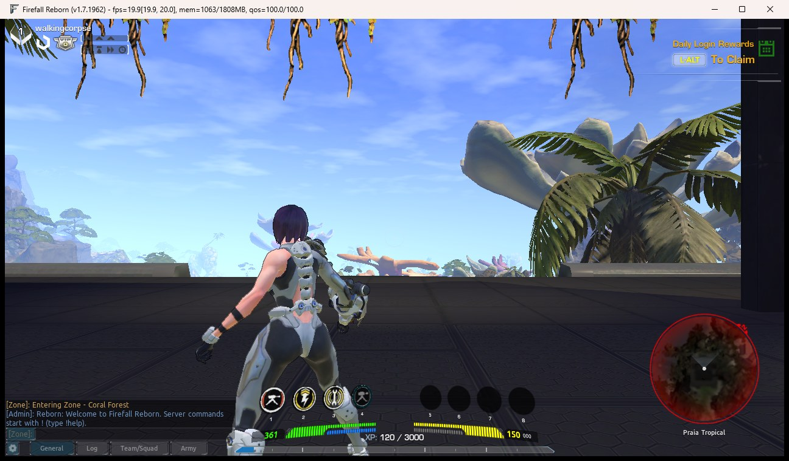

- **2026-11-18 02:17 (UTC+0)** - Done: Health, shields, death and respawn, resurrect by other players

  ![The second combat item is done: what happens when you go down, and how you get back up.

How it works now:
- When your health hits zero you go down and bleed out, with the game's own bleedout screen and its timer. If nobody helps, you respawn after 20 seconds.
- Respawn Now (R) brings you back at the spawn point straight away.
- A friend can walk up and hold E for 3 seconds to revive you where you lie, with a quarter of your health.
- New: Self Revive (G) works. It costs 250 Credits, stands you up where you fell with full health, and the Credits come off your wallet. If you can't afford it the button stays greyed out and Respawn Now still works.

About shields: Firefall's battleframes in this version have no separate shield bar (the game sends 0), so protection comes from abilities and armour effects, which already reduce damage.

Tested in game: down -> self revive took 250 of 400 Credits and stood the character up at full health; a second try with 150 left was refused and the bleedout screen stayed usable. Revives by a friend were tested earlier with two clients; the real hold-E prompt still needs the two-PC playtest.

Note: Credits come from daily rewards, repeatable missions and events in the original game (not from kills), so you'll earn them once that part of the economy is in. Release TBA, nothing to download yet.](images/progress/2026-11-18_021710_1.jpg)

- **2026-11-18 02:09 (UTC+0)** - Done: Weapon fire, projectiles, hit detection, headshots, damage numbers, ammo/reload (dbitems::Weapons, 318 templates)

- **2026-11-18 01:53 (UTC+0)** - Change to yesterday's squads: you now choose who is in your squad. Nobody joins automatically any more.

How it works:
- Invite with the game's own squad invite (or type !squad invite <name>). Your friend gets the game's own 'Squad Invitation' notice (press N to view) and can accept or decline it. Unanswered invites run out.
- Once they accept, both of you see the squad list top left (leader marked with a star) and the squad marker over each other's heads.
- !squad accept / !squad decline / !squad leave work as chat commands too; the leader can !squad kick <name> and hand over the lead with !squad lead <name>. Up to 5 per squad.
- Squad chat now only reaches your squad. Leaving the world takes you out of the squad.

Tested with two game clients: the invite notice showed up, the accept came through the game's own button path, both squad lists filled, and a kick cleared both. With nobody accepting, nobody joined.

Also new: the connection relay (how friends reach your world through Steam without any router setup) now carries the real game. On one PC we sent everything through Steam's own peer-to-peer network to ourselves: login, loading, the world and playing all ran through it with a perfect connection rating. What still needs a real friend is the internet path between two different homes.

Not there yet: the squad list shows level 1 for everyone, and the game's kick/promote buttons are wired by best guess (the !squad commands work for sure). Release TBA, nothing to download yet.

  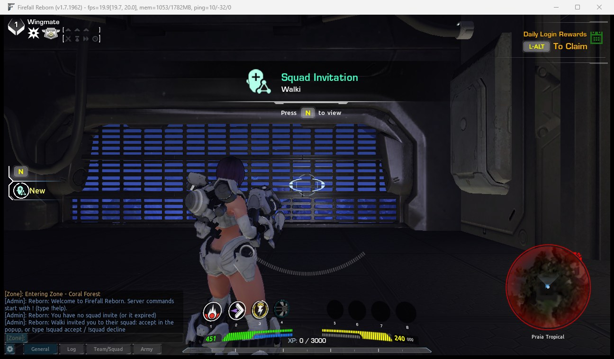

  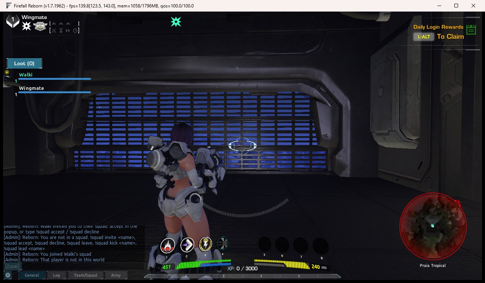

- **2026-11-18 01:23 (UTC+0)** - Done: Squad/party mapped to Steam friends; in-game chat works between players

  ![Everyone who joins your world is now in your squad, and the game's own squad list shows it.

Top left of the HUD you now see your squad: every player in the world with their health bar, and a star next to the leader (the host, or whoever was there first). Squadmates get the green squad marker over their heads, so you can find each other. When a friend leaves, the list clears; when they come back, it fills again.

How we got there: the old servers' squad system was never documented anywhere. We took the game client apart with Ghidra (a free reverse-engineering tool) and followed the code that builds the squad list back to the network message it reads, then made our server send that message the exact way the client expects.

Tested with two game clients in one world: both lists showed both players with the right leader; leaving cleared it; rejoining brought it back. Chat between players already worked.

Not there yet: the list shows level 1 for everyone, and the game's own invite / kick / promote buttons don't do anything yet (for now your squad = everyone in your world). Release TBA, nothing to download yet.](images/progress/2026-11-18_012332_1.jpg)

- **2026-11-18 01:22 (UTC+0)** - --help

- **2026-11-17 23:53 (UTC+0)** - Inviting now happens where it makes sense: in your world, after you've started hosting.

HOST A WORLD: pick FRIENDS CAN JOIN or INVITE ONLY, then START HOSTING. The window explains how inviting works, and no longer asks you to invite people before your world exists.

Once you're in your world:
- !friends lists your Steam friends who are online (those already in Firefall are marked).
- !invite <name> sends that friend a normal Steam game invite straight away. Part of the name is enough. Accepting it starts their Firefall and joins you. In an invite-only world it also lets them in.
- The Steam overlay's 'Invite to game' works too.

Only the host can send invites, so a guest can't send invites from the host's Steam account.

Tested: !friends listed the online friends from Steam, and !invite with a made-up name answered that no such friend is online (no real invites were sent during testing). Sending a real invite and joining through it is part of the upcoming two-PC session. Release TBA, nothing to download yet.

  

- **2026-11-17 20:33 (UTC+0)** - Hosting a world got its own window.

Press HOST A WORLD and a window opens where you pick who may come in:
- FRIENDS CAN JOIN: any of your Steam friends can join you (from the JOIN window in the game, or 'Join Game' in Steam).
- INVITE ONLY: only the friends you invite can get in. Anyone else is turned away.

Below that are your Steam friends who are online right now (those already in Firefall are marked), each with an INVITE button. Invites go out through Steam the moment your world starts, so your friend gets a normal Steam game invite, and accepting it starts their Firefall and joins you straight away. Then press START HOSTING.

In a friend's JOIN window, an invite-only world is marked '(invite only)'.

Tested on one PC: the window lists the real online friends, the choices and buttons work, and the menu talks to the launcher. The screenshot uses sample names. The full two-PC trip (invite, join, play) is next, in a real session with a friend. Release TBA, nothing to download yet.

  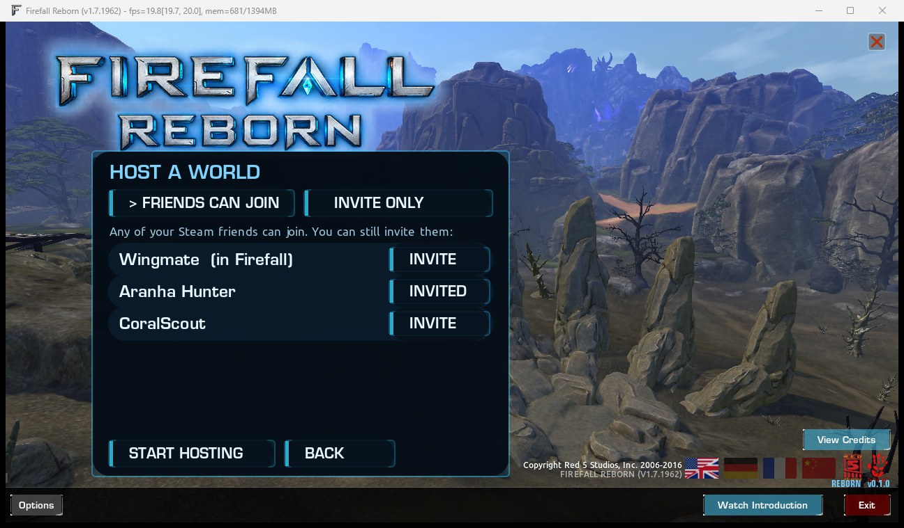

- **2026-11-17 20:26 (UTC+0)** - Two changes to playing with friends.

Join from Steam itself: when you host a world, Steam now knows how to join you. Your friends can right-click your name in their Steam friends list and pick 'Join Game', or you can invite them from the Steam overlay. Steam starts their Firefall, and the start menu goes straight into joining you, with no clicking through menus. If their game is already open, the menu picks the request up within a few seconds. Tested on one PC by starting the game the way Steam does for 'Join Game': the menu went straight into joining. The full trip between two PCs is still to be tried in a real session with a friend.

A bigger JOIN window: the friends window is now a large panel of its own, with room for seven friends, big names and a wide JOIN button on each row. Friends who are in Firefall but not hosting are marked '(playing)'. The screenshot uses sample names to show the layout.

Also noted for squads: putting everyone in a world into one squad works on the server side, but the game's own squad list needs a part of the protocol nobody has documented yet, so that's next on the research list. Release TBA, nothing to download yet.

  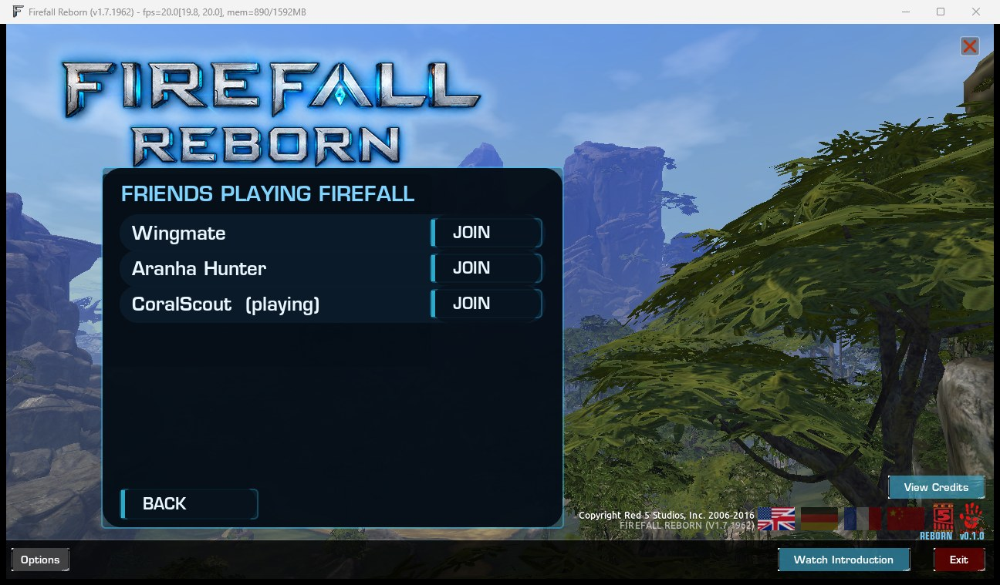

- **2026-11-17 19:22 (UTC+0)** - Two changes to the start menu, and two new items on the roadmap.

The JOIN window: the menu button is now simply called JOIN. Clicking it opens a window listing your Steam friends who are in Firefall right now, each with their own JOIN button. Friends who are hosting a world are listed first. If a friend is playing but not hosting, the window tells you to ask them to press HOST A WORLD. When nobody's online it says 'None of your friends are playing Firefall right now', as in the screenshot. BACK returns to the menu.

Fixed: the game went straight into the world instead of stopping at the start menu. That came from our test automation, which left its 'skip the menu' switches in the game's settings file. They're removed, and the test script now always takes them back out.

Added to Phase 8 (dedicated servers):
- Connect by address: a box in the JOIN window where you type a dedicated server's address, with a CONNECT button. It needs safe login over the network on the server side first, which is why it comes with the dedicated servers.
- Dedicated servers provide the full-detail textures: a server hands static.vtex0/1/2 (the three sharpest texture levels, 23 GB) to players who connect, like Red 5's servers streamed them, so you don't need the separate download.

Release TBA, nothing to download yet.

  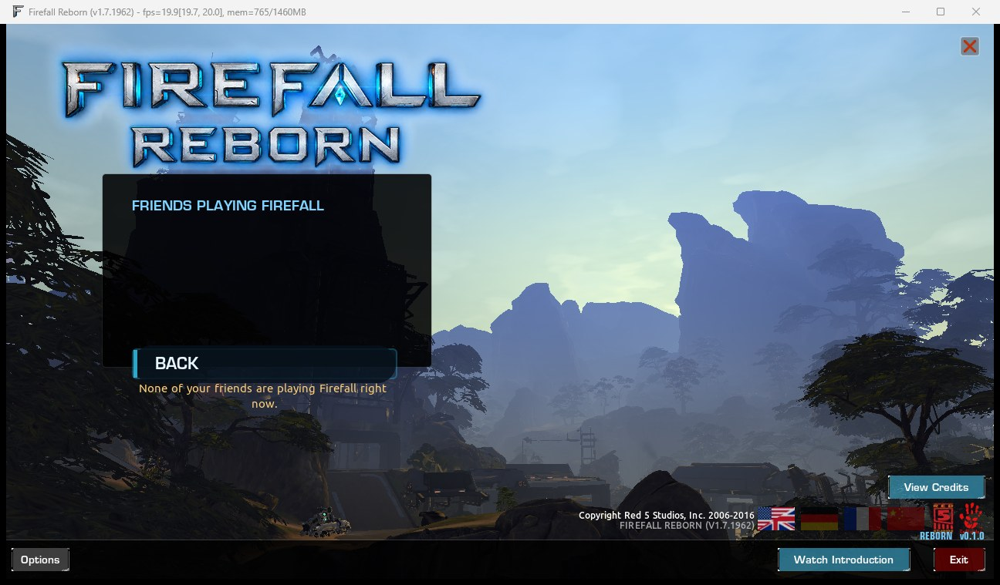

- **2026-11-17 19:12 (UTC+0)** - Done: Animations for everything (owner 2026-11-15: "make sure you add the animations for everything later"): NPC melee/attack _(started 2026-11-16 19:19 (UTC+0))_

- **2026-11-17 19:05 (UTC+0)** - Done: AI and encounters (rewrite of the first creature AI), NPCs, missions _(started 2026-11-17 15:24 (UTC+0))_

  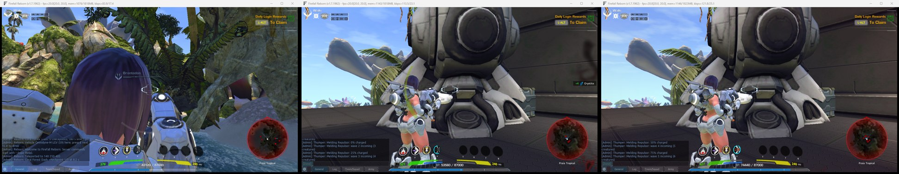

- **2026-11-17 18:54 (UTC+0)** - Two more parts of the world for our own server.

Carrying things: thumper parts, resonators, canisters, datapads and the rest of the game's carryable objects can now lie in the world. Walk up, press E and you pick it up; the game's own 'carrying' effect goes on you (a red resonator glows next to you). Press E again to put it down, and if you go down you drop it. Tested with a Red Resonator (screenshot).

Missions: a first mission system. A mission is a list of steps: go to a place, kill a number of a creature, or carry something from one place to another. The current step gets a waypoint marker, progress shows in chat, and finishing pays out XP (the game shows its own 'Mission Reward' pop-up) plus items. Two example missions for Coral Forest:
- Beach sweep: go down to the beach, kill three Aranha Workers, report back at the outpost. Tested in game: kills counted 1/3, 2/3, 3/3, then +6000 XP Mission Reward and 250 Crystite (screenshot).
- Lost resonator: a resonator lies near the Culex swarm, carry it back to the outpost.
For now you start one with !mission list and !mission start <number>.

Honest notes: these are our own missions, written in a simple file so more are easy to add. The game's 563 original missions had their logic on Red 5's servers, and the game's mission window uses messages nobody has documented yet, so it isn't used yet. Hooking up that window and bringing the real missions back is Phase 4 work. The waypoint marker is wired to the game's own mission marker, but I haven't seen it on screen yet.

Next in Phase 7: two more world events (melding repulsor, race), then animations part 2. Release TBA, nothing to download yet.

  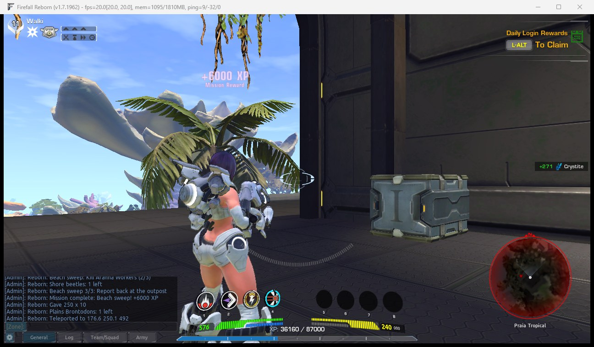

  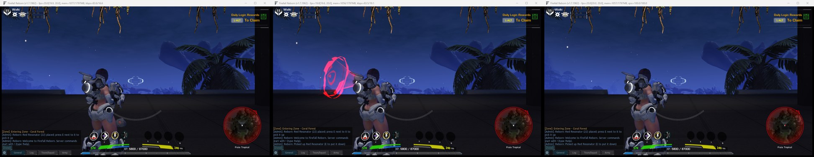

- **2026-11-17 15:44 (UTC+0)** - The first encounter runs on our own server: the thumper, Firefall's signature activity.

How it works: call a thumper down and it lands in front of you and starts digging for 90 seconds. Every 20 seconds a wave of the zone's creatures comes at it: Aranhas, Skivers and Culex, two creatures in the first wave and one more each wave. Chat shows how full it is (25%, 50%, 75%). Defend it until it's done and everyone within 60 m gets the haul: Crystite and Sifted Earth, more for each wave survived. If nobody is left standing near it for 15 seconds, it gives up and lifts off empty.

Tested in game (screenshots): an Accord Thumper standing on the platform, with an auto-turret beside it for backup. Five waves came, the turret and I fought them off (I went down once and got back up), and it finished with 650 Crystite and 45 Sifted Earth in the inventory. The kills along the way took my character from level 10 to 11.

Honest notes: the original thumper rules were on Red 5's servers and are lost, so the timing, waves and haul are our own design built from the game's real pieces, and easy to tune. Creatures go for the players for now, not the thumper itself, and there's no thumper progress window yet (the status is in chat). For now you start one with !thump. Calling one in from an item comes later.

Underneath it's a general encounter system, so the next world events (the melding repulsor, races) plug into the same frame. Release TBA, nothing to download yet.

  ![The first encounter runs on our own server: the thumper, Firefall's signature activity.

How it works: call a thumper down and it lands in front of you and starts digging for 90 seconds. Every 20 seconds a wave of the zone's creatures comes at it: Aranhas, Skivers and Culex, two creatures in the first wave and one more each wave. Chat shows how full it is (25%, 50%, 75%). Defend it until it's done and everyone within 60 m gets the haul: Crystite and Sifted Earth, more for each wave survived. If nobody is left standing near it for 15 seconds, it gives up and lifts off empty.

Tested in game (screenshots): an Accord Thumper standing on the platform, with an auto-turret beside it for backup. Five waves came, the turret and I fought them off (I went down once and got back up), and it finished with 650 Crystite and 45 Sifted Earth in the inventory. The kills along the way took my character from level 10 to 11.

Honest notes: the original thumper rules were on Red 5's servers and are lost, so the timing, waves and haul are our own design built from the game's real pieces, and easy to tune. Creatures go for the players for now, not the thumper itself, and there's no thumper progress window yet (the status is in chat). For now you start one with !thump. Calling one in from an item comes later.

Underneath it's a general encounter system, so the next world events (the melding repulsor, races) plug into the same frame. Release TBA, nothing to download yet.](images/progress/2026-11-17_154456_1.jpg)

- **2026-11-17 15:37 (UTC+0)** - Two more pieces of the world for our own server.

Turrets fight: a turret deployable now takes its real weapon from the game data. The anti-personnel auto-turret, for example, fires 60 damage every 175 ms out to 65 m. It shoots the nearest hostile creature it can see, turns its aim toward it, and the kill counts for the player who placed it (XP and loot). Tested: spawned Aranhas around an auto-turret and it killed them within seconds, the XP went to the player. For now the hits land instantly and the turret shows no muzzle flash or tracer; the shot visuals are still to come.

Vehicles: the server can now put the game's vehicles in the world, built from the game data: name, health and how the driver sits. Walk up and press E to get in the driver seat. The game shows its own vehicle HUD (health and speed gauge) and its 'Press W to accelerate' tip. Getting out puts you next to the vehicle. Your client drives the vehicle and the server passes its position to everyone nearby. Tested with the Cobra Cycle: it appeared on the platform, I got in, the vehicle HUD came up, and I got out again (screenshots). Actually driving it around still needs a real person on the keyboard to try. For now vehicles come from the command !vehicle <id> (e.g. 28 Cobra Cycle, 59 LGV, 53 Thumper Cart); calling one from your vehicle ability comes later.

Still to do in this part: thumpers and resource nodes, carryables, then encounters and missions. Release TBA, nothing to download yet.

  ![Two more pieces of the world for our own server.

Turrets fight: a turret deployable now takes its real weapon from the game data. The anti-personnel auto-turret, for example, fires 60 damage every 175 ms out to 65 m. It shoots the nearest hostile creature it can see, turns its aim toward it, and the kill counts for the player who placed it (XP and loot). Tested: spawned Aranhas around an auto-turret and it killed them within seconds, the XP went to the player. For now the hits land instantly and the turret shows no muzzle flash or tracer; the shot visuals are still to come.

Vehicles: the server can now put the game's vehicles in the world, built from the game data: name, health and how the driver sits. Walk up and press E to get in the driver seat. The game shows its own vehicle HUD (health and speed gauge) and its 'Press W to accelerate' tip. Getting out puts you next to the vehicle. Your client drives the vehicle and the server passes its position to everyone nearby. Tested with the Cobra Cycle: it appeared on the platform, I got in, the vehicle HUD came up, and I got out again (screenshots). Actually driving it around still needs a real person on the keyboard to try. For now vehicles come from the command !vehicle <id> (e.g. 28 Cobra Cycle, 59 LGV, 53 Thumper Cart); calling one from your vehicle ability comes later.

Still to do in this part: thumpers and resource nodes, carryables, then encounters and missions. Release TBA, nothing to download yet.](images/progress/2026-11-17_153738_1.jpg)

- **2026-11-17 15:24 (UTC+0)** - Started: AI and encounters (rewrite of the first creature AI), NPCs, missions

  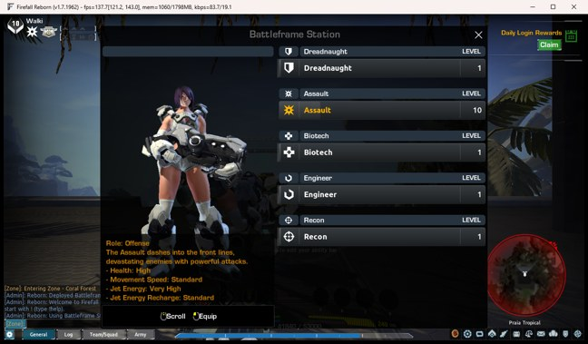

  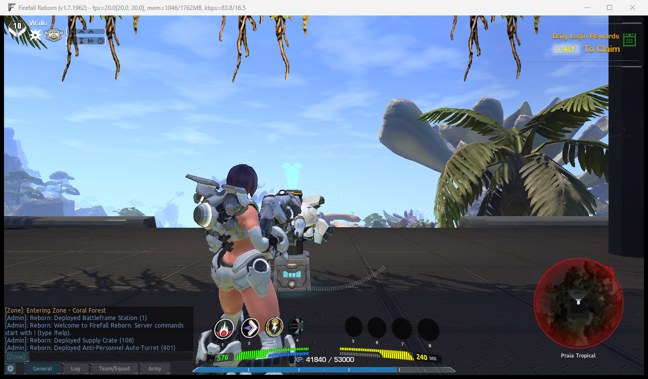

- **2026-11-17 15:09 (UTC+0)** - Done: Gameplay systems: chat + ! commands (!level, !pos, !tp), emotes, logout, ability activation + recharge + self status effects (Afterburner dash works) done 2026-10-21.

  

- **2026-11-17 15:01 (UTC+0)** - Done: Player character: loadout/stats/appearance from RIN data, spawn pose, movement relay. Character appears with head, hair, Assault armour, starting loadout and item stats; walk/sprin...

- **2026-11-17 14:49 (UTC+0)** - Three player features for our own server.

Switching battleframes: you can now change between the five battleframes (Assault, Biotech, Dreadnaught, Engineer, Recon). The server swaps your frame and puts you back where you stood, with that frame's armour, weapons, abilities and health. Each frame keeps its own level and XP, as in the original, so a new frame starts at level 1. Tested Assault to Biotech: new armour, the Biotech abilities on the bar, 361 health at level 1. For now you switch with the chat command !frame <name>. The game's own Battleframe Terminal is wired up on the server side (its frame list and its 'equip' request), but there's no terminal standing in the world yet, so that path is untested.

Fall damage: the original had it, but its numbers lived on Red 5's servers, so ours is our best guess. We measured the game's gravity (about 24 m/s², much heavier than Earth's). Landing faster than 35 m/s (about a 25 m drop) hurts, and around 90 m is lethal. Tested: a 23 m drop did nothing, a 55 m drop took 339 of 576 health. Meteor Strike landings, being thrown by a creature and your first landing after spawning don't count.

Reviving friends: when a player is down, a teammate within 4 m can hold E for 3 seconds to get them back up where they fell, with a quarter of their health. Tested with two players: one went down, the other revived them, and on screen the downed player stood back up. The game's 'hold E' prompt is wired to the same messages the original used but hasn't been seen on screen yet.

Still to do in this part: gear and visual slots from the inventory, consumables, scopes. Release TBA, nothing to download yet.

  ![Three player features for our own server.

Switching battleframes: you can now change between the five battleframes (Assault, Biotech, Dreadnaught, Engineer, Recon). The server swaps your frame and puts you back where you stood, with that frame's armour, weapons, abilities and health. Each frame keeps its own level and XP, as in the original, so a new frame starts at level 1. Tested Assault to Biotech: new armour, the Biotech abilities on the bar, 361 health at level 1. For now you switch with the chat command !frame <name>. The game's own Battleframe Terminal is wired up on the server side (its frame list and its 'equip' request), but there's no terminal standing in the world yet, so that path is untested.

Fall damage: the original had it, but its numbers lived on Red 5's servers, so ours is our best guess. We measured the game's gravity (about 24 m/s², much heavier than Earth's). Landing faster than 35 m/s (about a 25 m drop) hurts, and around 90 m is lethal. Tested: a 23 m drop did nothing, a 55 m drop took 339 of 576 health. Meteor Strike landings, being thrown by a creature and your first landing after spawning don't count.

Reviving friends: when a player is down, a teammate within 4 m can hold E for 3 seconds to get them back up where they fell, with a quarter of their health. Tested with two players: one went down, the other revived them, and on screen the downed player stood back up. The game's 'hold E' prompt is wired to the same messages the original used but hasn't been seen on screen yet.

Still to do in this part: gear and visual slots from the inventory, consumables, scopes. Release TBA, nothing to download yet.](images/progress/2026-11-17_144917_1.jpg)

  ![Three player features for our own server.

Switching battleframes: you can now change between the five battleframes (Assault, Biotech, Dreadnaught, Engineer, Recon). The server swaps your frame and puts you back where you stood, with that frame's armour, weapons, abilities and health. Each frame keeps its own level and XP, as in the original, so a new frame starts at level 1. Tested Assault to Biotech: new armour, the Biotech abilities on the bar, 361 health at level 1. For now you switch with the chat command !frame <name>. The game's own Battleframe Terminal is wired up on the server side (its frame list and its 'equip' request), but there's no terminal standing in the world yet, so that path is untested.

Fall damage: the original had it, but its numbers lived on Red 5's servers, so ours is our best guess. We measured the game's gravity (about 24 m/s², much heavier than Earth's). Landing faster than 35 m/s (about a 25 m drop) hurts, and around 90 m is lethal. Tested: a 23 m drop did nothing, a 55 m drop took 339 of 576 health. Meteor Strike landings, being thrown by a creature and your first landing after spawning don't count.

Reviving friends: when a player is down, a teammate within 4 m can hold E for 3 seconds to get them back up where they fell, with a quarter of their health. Tested with two players: one went down, the other revived them, and on screen the downed player stood back up. The game's 'hold E' prompt is wired to the same messages the original used but hasn't been seen on screen yet.

Still to do in this part: gear and visual slots from the inventory, consumables, scopes. Release TBA, nothing to download yet.](images/progress/2026-11-17_144917_2.jpg)

- **2026-11-17 14:25 (UTC+0)** - Done: World: entities, scoping, views/keyframes/updates (GSS), zone load from game data. Real client now shows terrain + HUD + own character from our server; still to do: scoping of othe...

- **2026-11-17 14:11 (UTC+0)** - Firefall Reborn now runs entirely on our own server code. The launcher and the installer start Reborn.Server, and PIN (the community server we started from, which has no licence) is no longer in the installer at all. That also settles the PIN licence question: we no longer need anyone's permission to ship.

What this means for players: nothing changes in how you start the game. Click Play in Steam and the launcher starts the local services and our server in the background, the same as before. Checked today with a fresh launch: the launcher started reborn-server, the character logged in and landed in Coral Forest. The installer shrank from 468 MB to 416 MB of server files.

The collision and physics item is ticked as well. It has been done since 15 November: our own reader for the game's Havok collision data (terrain, floors and rocks; walls block shots and line of sight) plus A* path finding for creatures.

Phase 7 finish line (replace everything PIN did, plus the frameworks later phases fill with content), in build order:
1. World: range-based visibility, zone transfer, logout and leave-zone
2. Player: switching battleframes (all 5), gear slots, consumables, scopes, reviving other players, jetpack energy and fall damage
3. Admin commands
4. Deployables and turrets, vehicles, thumpers and resource nodes, carryables
5. Encounter and mission frameworks with working examples (thumper encounter, melding repulsor, LGV race)
6. Animations part 2: hit reactions, reloads, idle, NPC ability animations

Release still TBA, nothing to download yet.

- **2026-11-17 14:00 (UTC+0)** - Three multiplayer follow-ups for the shared world.

Chat channels now behave like channels: Say reaches players within 50 m, Yell within 200 m, Whisper only the player you name (if nobody by that name is in your world you get a 'not in this world' notice instead). Zone chat and the other channels still reach everyone in the world; squad, platoon and army chat wait for squads and armies to exist. The Say/Yell ranges are our best guess (the original values lived on Red 5's servers) and can be tuned.

Enemy camps now match the level of the player who wakes them, not the level of whoever logged in first. A level 1 friend walking up to a camp alone gets level 1 enemies; a level 10 player gets level 10.

No PvP in the open world, the same as the original outside duels and arenas: your shots and abilities cannot hurt other players, while healing abilities still reach them. Checked with two clients on one PC: when one player goes down, the other sees them collapse, then stand back up on respawn (screenshot is from the second player's view).

Next: Steam friend join flow, squads and squad chat, more creatures. Release still TBA, nothing to download yet.

  ![Three multiplayer follow-ups for the shared world.

Chat channels now behave like channels: Say reaches players within 50 m, Yell within 200 m, Whisper only the player you name (if nobody by that name is in your world you get a 'not in this world' notice instead). Zone chat and the other channels still reach everyone in the world; squad, platoon and army chat wait for squads and armies to exist. The Say/Yell ranges are our best guess (the original values lived on Red 5's servers) and can be tuned.

Enemy camps now match the level of the player who wakes them, not the level of whoever logged in first. A level 1 friend walking up to a camp alone gets level 1 enemies; a level 10 player gets level 10.

No PvP in the open world, the same as the original outside duels and arenas: your shots and abilities cannot hurt other players, while healing abilities still reach them. Checked with two clients on one PC: when one player goes down, the other sees them collapse, then stand back up on respawn (screenshot is from the second player's view).

Next: Steam friend join flow, squads and squad chat, more creatures. Release still TBA, nothing to download yet.](images/progress/2026-11-17_140023_1.jpg)

- **2026-11-16 20:00 (UTC+0)** - Done: Shared world: players in a zone see each other (character, movement, shots, health, downed/death, respawn, level-up, chat) and fight the same enemies (shared camps; each enemy atta...

- **2026-11-16 19:35 (UTC+0)** - Own server update: knock-backs work both ways now. Meteor Strike's impact throws the enemies it hits back from the crater, as the game's own ability data says it should.

- **2026-11-16 19:19 (UTC+0)** - Own server update, animations part 1: enemies now play their death animation when you kill them (an Aranha flips over and collapses) instead of freezing upright until they vanish, and knock-backs work: a Brontodon's charge sends you flying about 13 m. Creature attack animations (bites, pounces, charges) already played; next are hit reactions and the rest of the list.

- **2026-11-16 19:19 (UTC+0)** - Started: Animations for everything (owner 2026-11-15: "make sure you add the animations for everything later"): NPC melee/attack

- **2026-11-16 19:05 (UTC+0)** - Own server fix: levelling up now raises your health properly. Before, your maximum went up but you stayed at your old health; now the extra health is yours straight away (an Assault goes from 576 at level 10 to 801 at level 12, following the game's own level table).

- **2026-11-16 18:59 (UTC+0)** - Own server update: two more creatures from the old fan wiki live near Praia Tropical now. A pair of Culex (flying insects with a ranged stinger) hover east of the beach, and a Skiver nest to the west: Skivers leap at you from mid range and spit acid. Both render fully textured with their real names, and the death screen tells you which one got you.

- **2026-11-16 18:50 (UTC+0)** - Own server update: Brontodons now throw boulders. The herd near Praia Tropical leaves you alone until you shoot one; then it throws a boulder from up to 20 m, charges you and sweeps with its tusks. (The plain Brontodon in the game data has no boulder, so the herd uses the Brontodon variant that does.)

- **2026-11-16 16:50 (UTC+0)** - Own server update: the XP pop-up now says KILL under the XP instead of 'unknown', and enemies show their real level on their health plates (it was 0). The Giant Aranha's acid now splashes where it lands instead of around the spider itself, and leaves you burning briefly: the game's own acid burn effect now ticks on the server (status effects with timed updates work in general now). Next: more creatures from the old fan wiki, the Brontodon's boulder throw, animations.

- **2026-11-16 12:14 (UTC+0)** - Done: Finest virtual-texture levels static.vtex0-2 (23 GB, streamed by the dead servers): the real files, shared by

- **2026-11-16 07:55 (UTC+0)** - Own server fix: creature path finding is smarter. Creatures now step down off ledges, no longer get stuck inside rocks, and when they can't reach you (you're up on a platform) they wait at the closest spot instead of wandering into caves underneath.

- **2026-11-16 07:47 (UTC+0)** - Own server update: three fixes. (1) Your health now comes from your battleframe, its gear and its level instead of a flat 1000 (a level 10 Assault has 576, it grows as you level). (2) The launcher no longer fails with 'could not create your account (500)' after the game was closed badly: it now waits until the database has finished starting. (3) Creatures find their way round rocks and buildings: when something blocks them they work out a path (A*) over the real world collision, e.g. Aranha Workers walked 60 m round the cliff and up the slope toward a player standing on a platform above them.

  ![Own server update: three fixes. (1) Your health now comes from your battleframe, its gear and its level instead of a flat 1000 (a level 10 Assault has 576, it grows as you level). (2) The launcher no longer fails with 'could not create your account (500)' after the game was closed badly: it now waits until the database has finished starting. (3) Creatures find their way round rocks and buildings: when something blocks them they work out a path (A*) over the real world collision, e.g. Aranha Workers walked 60 m round the cliff and up the slope toward a player standing on a platform above them.](images/progress/2026-11-16_074743_1.jpg)

- **2026-11-15 12:35 (UTC+0)** - Own server update: the world's creatures are the real ones now, fully textured: Aranha Workers that leap at you, a Giant Aranha that spits acid, and a herd of Brontodons that ignore you until you shoot one, then charge and knock you back. Their move sets come from the old Firefall fan wiki (rescued from the Internet Archive), since the original creature AI lived only on Red 5's servers. Next: enemy names on health bars and XP pop-ups, acid pools, more creatures.

- **2026-11-15 11:59 (UTC+0)** - Own server update: creatures fight like creatures now. Aranhas and other melee creatures use the game's own creature attacks: a bite with its attack animation (damage from the original level tables), and a pounce where they leap at you from up to 16 m away and land a hard hit. Next: more enemy moves (lunges, knock-back) and more animations.

- **2026-11-15 11:33 (UTC+0)** - Own server update: the supercharge meter is in. Damage you deal fills it (about 2% per hit on an Aranha), Shockwave needs a full bar and empties it, and the supercharge power-up fills it straight away. Abilities whose conditions aren't met are now refused properly instead of half-firing. Next: enemy special attacks.

- **2026-11-15 11:25 (UTC+0)** - Own server update: melee works. The swing plays its animation and hits the nearest enemy in front of you for the module's Melee Damage. With Meteor Strike, Overcharge and Shockwave already working, all four starter abilities now do their job. Next: the supercharge meter for Shockwave.

- **2026-11-15 11:21 (UTC+0)** - Own server update: Shockwave works. It charges, then sends its wave forward, and every enemy the wave touches takes the module's Shockwave Damage (tested: one wave killed an Aranha). Overcharge runs for its full time as well. Next: melee, and the supercharge meter that Shockwave needs (for now you can use it again straight away).

- **2026-11-15 11:16 (UTC+0)** - Own server update: boosts now really work. The damage power-up doubles the damage you deal, the armour power-up cuts the damage you take to a tenth (tested: Aranha bites went from 84 to 8 for the boost's 7 seconds), and Meteor Strike's leap gives its real damage protection. Overcharge's no-ammo effect is counted on the server too. Next: Overcharge, Shockwave and melee themselves.

- **2026-11-15 11:10 (UTC+0)** - Own server fix: enemy health bars now show as soon as you aim at an enemy, not only after your first hit. Still missing: enemy names and levels on those bars.

- **2026-11-15 10:58 (UTC+0)** - Own server update: the ability system has started. The server now runs the game's own ability scripts: health packs heal you, ammo packs refill your weapons, boost power-ups light up, and Meteor Strike's landing now damages every enemy in its blast radius (using the module's real Crater Damage and radius). Next: damage/armour boosts counted on the server, then Overcharge, Shockwave and melee.

- **2026-11-15 04:46 (UTC+0)** - Own server update: kills now give XP and loot. XP comes with the +XP pop-up, fills the XP bar and levels your battleframe up (saved to your character). Loot rolls from the game's own loot tables (checked for all 3109 enemy types): Crystite and items land in your inventory and stay there between sessions, and power-ups trigger on pickup. Next: the ability system (power-up heals and ammo, enemy special attacks, your own abilities).

- **2026-11-15 03:43 (UTC+0)** - Own server update: the world now has real collision (our own reader for the game's Havok collision data): enemies walk on terrain, floors and rocks, steer around obstacles, and walls and hills block shots both ways. Enemy camps are placed around Praia Tropical (Aranhas, Dark Ones, Chosen, beetles); they wake up when you come near and come back a couple of minutes after you clear them, with status messages in chat. Next: loot and XP, then animations.

  

- **2026-11-15 02:39 (UTC+0)** - Own server progress: combat works. Enemies from the game's own data can be spawned (soldiers, Aranhas, Brontodons) with their real models, names, factions and weapons. You can shoot them (weapon damage from game data, floating damage numbers) and they fight back: creatures close in and bite, soldiers keep their distance and fire at their weapon's rate. Enemy health and damage scale with level from the original level tables, and the death screen shows who killed you. Also fixed: Meteor Strike launch and impact, flashing energy bar, screen shake. Next: terrain and walls for enemies and shots, then animations.

  ![Own server progress: combat works. Enemies from the game's own data can be spawned (soldiers, Aranhas, Brontodons) with their real models, names, factions and weapons. You can shoot them (weapon damage from game data, floating damage numbers) and they fight back: creatures close in and bite, soldiers keep their distance and fire at their weapon's rate. Enemy health and damage scale with level from the original level tables, and the death screen shows who killed you. Also fixed: Meteor Strike launch and impact, flashing energy bar, screen shake. Next: terrain and walls for enemies and shots, then animations.](images/progress/2026-11-15_023911_1.jpg)

  ![Own server progress: combat works. Enemies from the game's own data can be spawned (soldiers, Aranhas, Brontodons) with their real models, names, factions and weapons. You can shoot them (weapon damage from game data, floating damage numbers) and they fight back: creatures close in and bite, soldiers keep their distance and fire at their weapon's rate. Enemy health and damage scale with level from the original level tables, and the death screen shows who killed you. Also fixed: Meteor Strike launch and impact, flashing energy bar, screen shake. Next: terrain and walls for enemies and shots, then animations.](images/progress/2026-11-15_023911_2.jpg)

- **2026-10-20 19:05 (UTC+1)** - Done: Two repos: private source repo + public releases repo (README, screenshots, Setup.exe asset, version tags)

- **2026-10-20 19:03 (UTC+1)** - Done: Auto-updater: on launch check the public releases repo for a newer mod version, download (sha256 checked), apply, restart.

- **2026-10-20 18:53 (UTC+1)** - Done: Uninstaller / restore: put every *.reborn.bak back (built into the installer; tested end to end on the Steam copy: originals back, saves kept, reinstall works)

- **2026-10-20 18:50 (UTC+1)** - Done: Replace Red 5's licence agreement screen (first-run EULA mentions their servers and the RedHanded anti-cheat) with a short

- **2026-10-20 18:41 (UTC+1)** - Done: Quiet logging (previous session kept as .prev.log), health checks (incl. a warning if a server dies mid-game), TCP ports configurable in reborn.json, clear error naming the log if ...

- **2026-10-20 18:35 (UTC+1)** - Done: Account identity from the Steam ID (one account per Steam user; first user inherits the existing account), saved per player

- **2026-10-20 18:31 (UTC+1)** - Done: Installer exe (src/Reborn.Setup + src/Reborn.Patcher, no Python/.NET needed by the player): finds the Steam library, _(started 2026-10-20 15:32 (UTC+1))_

- **2026-10-20 15:32 (UTC+1)** - Started: Installer exe (src/Reborn.Setup + src/Reborn.Patcher, no Python/.NET needed by the player): finds the Steam library,

- **2026-10-20 15:32 (UTC+1)** - Done: Self-contained server bundle (bundled .NET runtime, published RIN/PIN, portable Postgres) so nothing else is installed

- **2026-10-20 15:32 (UTC+1)** - Done: Launcher exe (src/Reborn.Launcher) is the file Steam runs (system/bin/FirefallClient.exe --steam, the real client is

- **2026-10-20 15:22 (UTC+1)** - Public repository is live. Local server, launcher, Reborn menu and character screens already run the real game; release date TBA.

  

  
