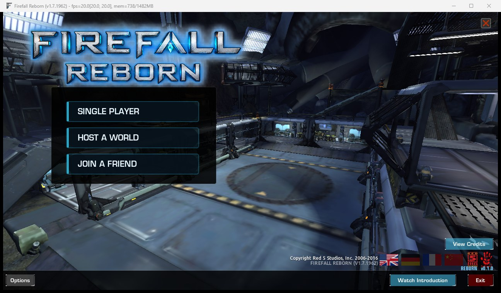
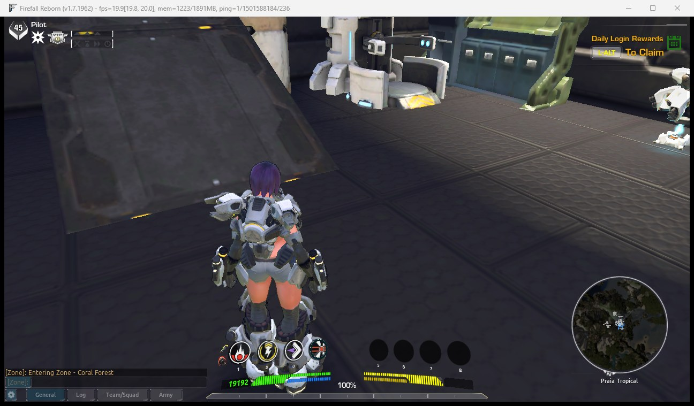

# Progress log

Newest first. Release date: TBA.

- **2026-10-20 18:31 (UTC+1)** - Done: Installer exe (src/Reborn.Setup + src/Reborn.Patcher, no Python/.NET needed by the player): finds the Steam library, _(started 2026-10-20 15:32 (UTC+1))_

- **2026-10-20 15:32 (UTC+1)** - Started: Installer exe (src/Reborn.Setup + src/Reborn.Patcher, no Python/.NET needed by the player): finds the Steam library,

- **2026-10-20 15:32 (UTC+1)** - Done: Self-contained server bundle (bundled .NET runtime, published RIN/PIN, portable Postgres) so nothing else is installed

- **2026-10-20 15:32 (UTC+1)** - Done: Launcher exe (src/Reborn.Launcher) is the file Steam runs (system/bin/FirefallClient.exe --steam, the real client is

- **2026-10-20 15:22 (UTC+1)** - Public repository is live. Local server, launcher, Reborn menu and character screens already run the real game; release date TBA.

  

  
