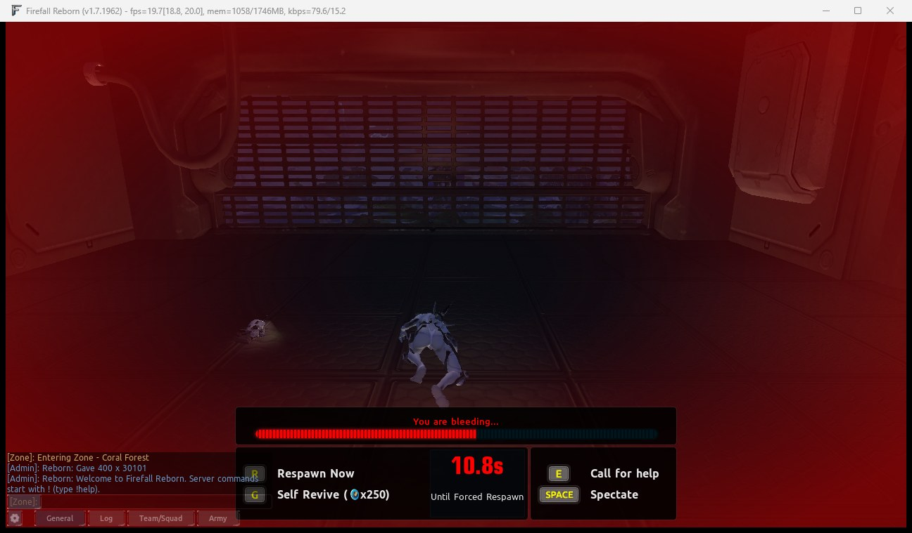
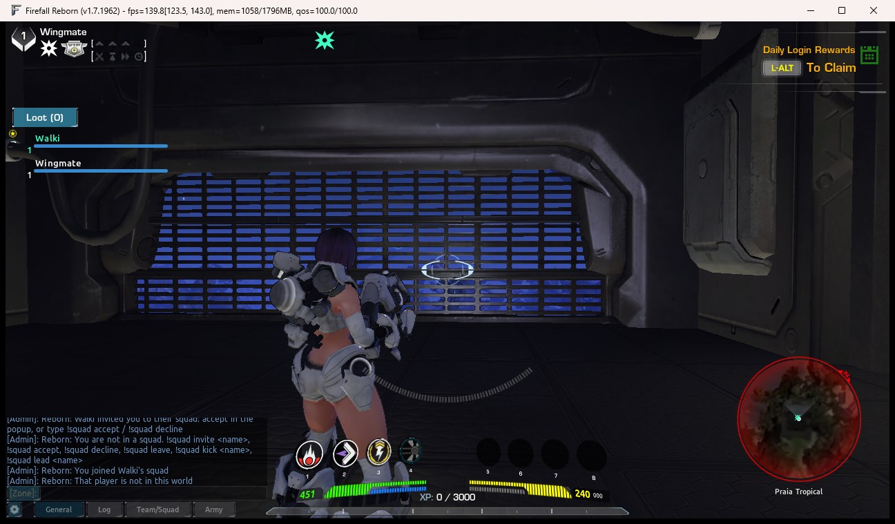

  

<h3 align="center">Firefall is back. Play it alone, or with your Steam friends.</h3>

  
  
  

---

**Firefall Reborn** is a fan-made revival of *Firefall*, the free-to-play open-world shooter by Red 5 Studios whose servers
shut down in 2017. It plugs into your own Steam copy of the game, edits the game files directly (no overlays), and runs the
whole world on your PC, so the game starts again and keeps working.

> **Release date: TBA.** Nothing is available to download yet. This page follows the build as it happens.

## What you will get

- **One click to play.** Press Play in Steam. The game starts its own local server in the background and shuts it down when you quit.
- **Single Player.** The whole game scaled so one person can beat it. No PvP.
- **Host a World / Join a Friend.** Invite Steam friends and play together, with no router setup. Multiplayer is harder and has PvP.
- **Everything Firefall had, rebuilt:** the campaign, hundreds of missions and world events, the original creatures, bosses and NPCs,
  operations, raids and dungeons, crafting, thumpers, vehicles, battleframes and abilities.
- **Steam achievements that really unlock.** All 117 of them.
- **A free in-game currency.** The old premium store comes back, paid for with Red Beans you **earn by playing**. No real money, ever.
- **One installer.** It finds your Firefall folder, installs everything and keeps itself updated.
- **A modern look (later).** Upscaled textures, a refreshed UI and modern render settings, so it looks like it was made today.

## Latest from the build

<!--SHOTS-->

  
  
  
  

**Your Steam name is your name in game + Engineer turrets build** - *2026-11-18 02:43 (UTC+0)*

Two changes.

Your Steam name, everywhere: every player's character now carries their full Steam name - over your head, in chat, in the squad list, in the JOIN window. It's checked every time you start the game, so if you change your Steam name, your character follows. A name you typed on the character screen is replaced by your Steam name the next time you start. If someone else in the same world already uses your exact name, you get a number after it (for example walkingcorpse2). Spaces and symbols are left out (letters, numbers, _ and - stay) so other players can whisper you by name.

Engineer turrets: the Engineer's Heavy Turret ability now really builds its turret where you aim (up to 4 m away, one at a time - placing a new one replaces the old). It fights for you: in our test it shot the first Aranha that came into range. This came out of a check of every ability on all five battleframes; the other abilities that still skip a step (dashes like Afterburner and Charge, some timed effects, the Supply Station and Remote Explosive placement) are next on the list.

Tested: names for three cases (our pre-Steam test name, a name typed in game, and a second account with the same Steam name), the turret in game with the Engineer. Release TBA, nothing to download yet.

---

**The second combat item is done: what happens when you go down, and how you get back up.** - *2026-11-18 02:17 (UTC+0)*

Done: Health, shields, death and respawn, resurrect by other players

---

**Squads are now by invitation + the game runs through the Steam relay** - *2026-11-18 01:53 (UTC+0)*

Change to yesterday's squads: you now choose who is in your squad. Nobody joins automatically any more.

How it works:
- Invite with the game's own squad invite (or type !squad invite <name>). Your friend gets the game's own 'Squad Invitation' notice (press N to view) and can accept or decline it. Unanswered invites run out.
- Once they accept, both of you see the squad list top left (leader marked with a star) and the squad marker over each other's heads.
- !squad accept / !squad decline / !squad leave work as chat commands too; the leader can !squad kick <name> and hand over the lead with !squad lead <name>. Up to 5 per squad.
- Squad chat now only reaches your squad. Leaving the world takes you out of the squad.

Tested with two game clients: the invite notice showed up, the accept came through the game's own button path, both squad lists filled, and a kick cleared both. With nobody accepting, nobody joined.

Also new: the connection relay (how friends reach your world through Steam without any router setup) now carries the real game. On one PC we sent everything through Steam's own peer-to-peer network to ourselves: login, loading, the world and playing all ran through it with a perfect connection rating. What still needs a real friend is the internet path between two different homes.

Not there yet: the squad list shows level 1 for everyone, and the game's kick/promote buttons are wired by best guess (the !squad commands work for sure). Release TBA, nothing to download yet.
<!--/SHOTS-->

Newer screenshots are added here as the project moves along; the full history is in [CHANGELOG.md](CHANGELOG.md).

## Screenshots

  
  

  
  

Work in progress, running the real game against the local server.

## Progress

<!--PROGRESS-->
**Overall: `█████░░░░░░░░░░░░░░░` 24%** (32 of 138 roadmap items done) - last update 2026-11-18 04:58 (UTC+0)

| Phase | Progress | Done |
|---|---|---|
| Phase 0 - Make it run (DONE) | `████████████` 100% | 7/7 |
| Phase 1 - Launcher and install (next) | `████████████` 100% | 10/10 |
| Phase 2 - Steam: achievements, friends, invites | `████░░░░░░░░` 32% | 2/11 |
| Phase 3 - The game itself (server side, from the game's own data) | `█░░░░░░░░░░░` 5% | 2/38 |
| Phase 4 - Single player vs multiplayer | `░░░░░░░░░░░░` 0% | 0/7 |
| Phase 5 - Polish and what the deep search found missing | `█░░░░░░░░░░░` 10% | 1/10 |
| Phase 6 - Modernisation: make it look and feel like it was made today | `░░░░░░░░░░░░` 0% | 0/33 |
| Phase 7 - Our own server (replace PIN) - decided 2026-10-20 | `████████████` 100% | 10/10 |
| Phase 8 - Dedicated servers and a server browser (owner 2026-10-29) | `░░░░░░░░░░░░` 0% | 0/12 |
<!--/PROGRESS-->

The full plan, with every system listed, is in **[ROADMAP.md](ROADMAP.md)**. Each time something on it is finished it is ticked
off with the date and time, logged in **[CHANGELOG.md](CHANGELOG.md)** and announced on **[Discord](https://discord.gg/xNs7GknyBD)**.

## How it works (short version)

Firefall's servers are gone, but the game client and all its data are still on your disk. Reborn runs the server pieces locally:
a small database, a login/character server and a game server speaking the original network protocol. A launcher replaces the
game's start file so Steam starts everything in order. A few bytes in the game executable and some of the game's UI and text files
are patched, with a backup of every original, so the menu, branding and server address are ours.

## What you need

- Windows 10 or 11
- **Your own copy of Firefall on Steam** (it is still in your library if you owned it). Reborn does not include or distribute any
  game files.
- A PC that could run Firefall in 2014 (it is a 32-bit game)

## FAQ

**Is it playable now?** You can log in, make a character and walk around the world. Combat, enemies, missions and the rest are being
rebuilt step by step, in the order on the roadmap.

**Will it be free?** Yes.

**Will there be a download?** Yes, as a single installer, on this repository's Releases page. The date is not set (TBA) and nothing
is published until it is ready.

**Is it legal?** It is an unofficial fan project, not affiliated with or endorsed by Red 5 Studios or anyone who owns Firefall.
It contains none of the game's files and needs your own copy. Firefall and all related names and art belong to their owners.

**Why Steam?** Friends join through Steam, and achievements are unlocked through your Steam account.

## Built on the shoulders of

The community work that made a revival possible, with thanks:
**[The Melding Wars](https://github.com/themeldingwars)** (protocol research and server emulation: PIN, RIN.WebAPI, AeroMessages,
FauFau, SDBrowser) and everyone who documented the game's formats and network protocol. Special thanks to **DarkCisum**
for the full-detail texture levels (static.vtex0-2) the Steam install is missing.

## Follow along

- Roadmap: [ROADMAP.md](ROADMAP.md)
- Progress log: [CHANGELOG.md](CHANGELOG.md)
- **Discord: [discord.gg/xNs7GknyBD](https://discord.gg/xNs7GknyBD)** - updates, screenshots and gameplay videos as they happen, general chat and bug reports

Firefall Reborn is a fan project. Release date: TBA.

