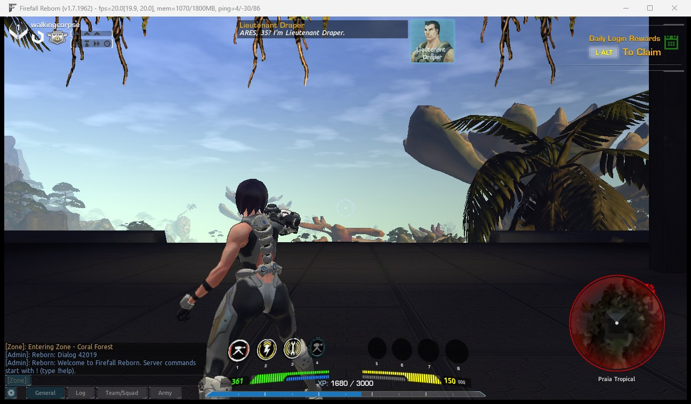
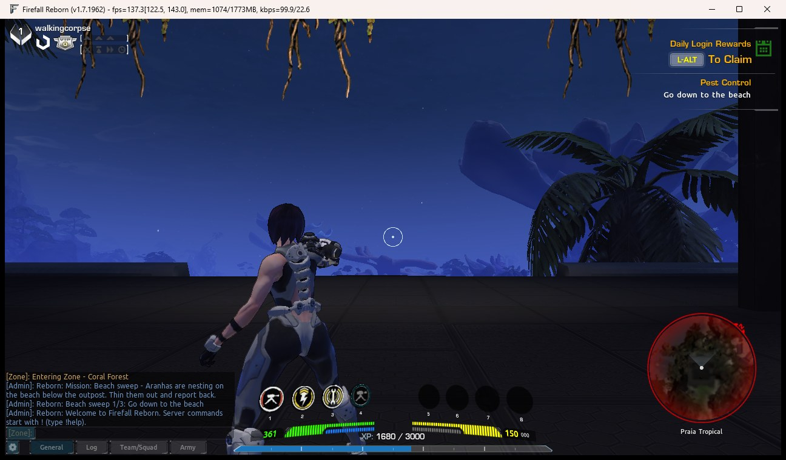
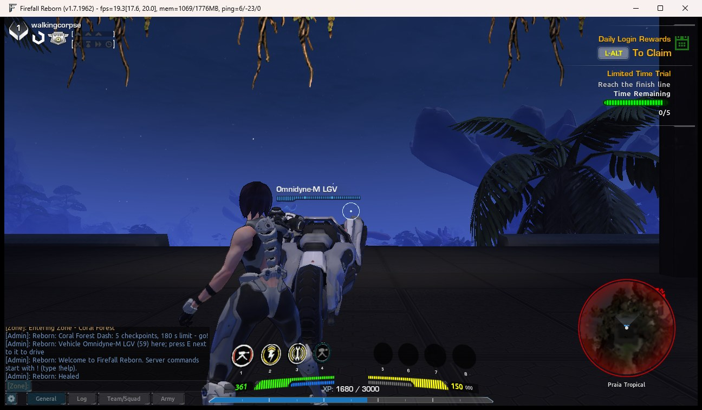
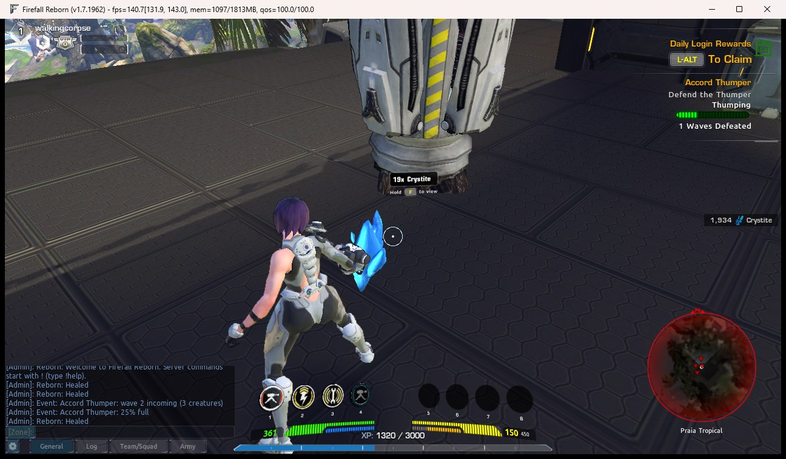
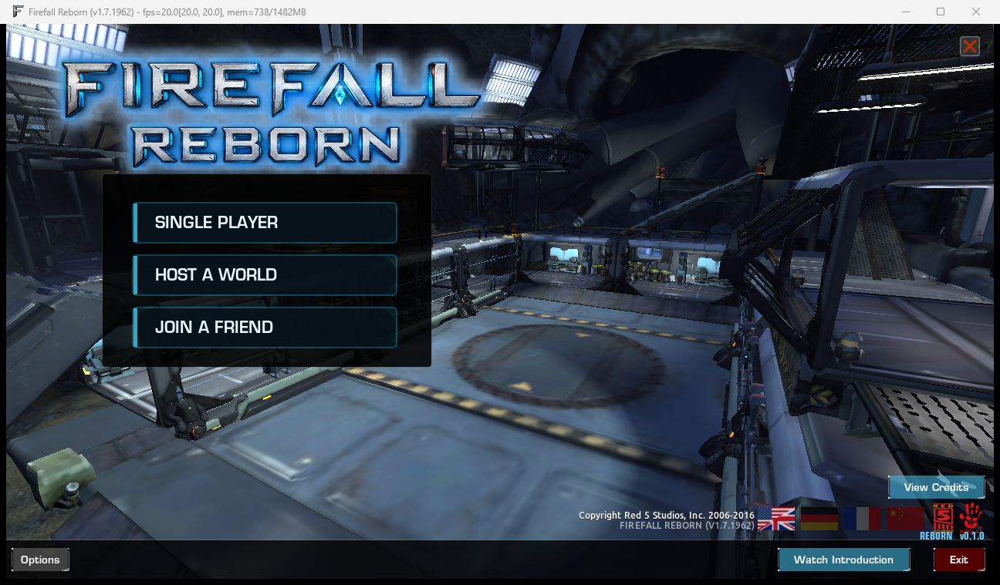
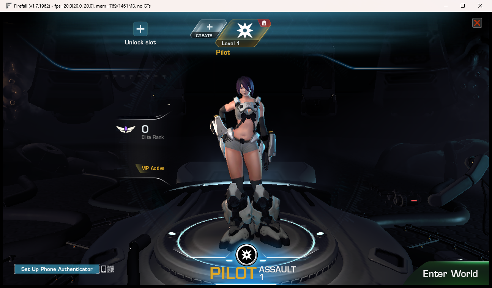
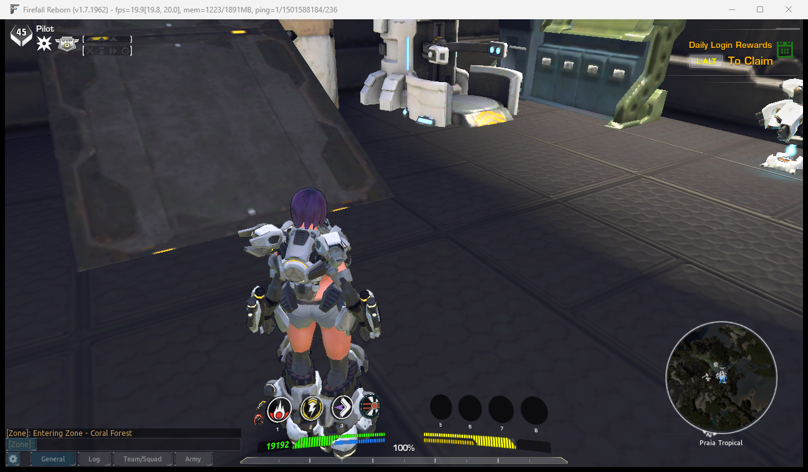

  

<h3 align="center">Firefall is back. Play it alone, or with your Steam friends.</h3>

  
  
  

---

**Firefall Reborn** is a fan-made revival of *Firefall*, the free-to-play open-world shooter by Red 5 Studios whose servers
shut down in 2017. It plugs into your own Steam copy of the game, edits the game files directly (no overlays), and runs the
whole world on your PC, so the game starts again and keeps working.

> **Release date: TBA.** Nothing is available to download yet. This page follows the build as it happens.

## What you will get

- **One click to play.** Press Play in Steam. The game starts its own local server in the background and shuts it down when you quit.
- **Single Player.** The whole game scaled so one person can beat it. No PvP.
- **Host a World / Join a Friend.** Invite Steam friends and play together, with no router setup. Multiplayer is harder and has PvP.
- **Everything Firefall had, rebuilt:** the campaign, hundreds of missions and world events, the original creatures, bosses and NPCs,
  operations, raids and dungeons, crafting, thumpers, vehicles, battleframes and abilities.
- **Steam achievements that really unlock.** All 117 of them.
- **A free in-game currency.** The old premium store comes back, paid for with Red Beans you **earn by playing**. No real money, ever.
- **One installer.** It finds your Firefall folder, installs everything and keeps itself updated.
- **A modern look (later).** Upscaled textures, a refreshed UI and modern render settings, so it looks like it was made today.

## Latest from the build

<!--SHOTS-->

  
  
  
  

**The story campaign is coming back - with the original voices** - *2026-11-18 16:25 (UTC+0)*

We've started rebuilding the Accord story campaign, mission by mission, as close to the original as we can. First up: Mission 1, 'Everything is Shadow'.

What we have so far:
- The mission's own map (WARCOM) is in the game files and loads.
- The original voice acting works. The server can play any of the game's dialog scenes, with the voice, the character portrait and the subtitles, exactly as the old server did. Tested: Lieutenant Draper's intro ('ARES, 35? I'm Lieutenant Draper.').
- The whole mission script is in the game files as dialog lines: Draper's briefing in Copacabana, gliding to WARCOM, Captain Fuller inside, Aranha in the halls, the forced blast door, the fallen security team, the stealthed Chosen ambush revealed by the fire-suppression halon, the Arclight data, the Ultimate Ability fight and the trip back to New Eden. We've written it all out in order.
- The live-server recording shows exactly where Lieutenant Draper stood in Copacabana.

What has to be rebuilt by hand: where things are inside WARCOM, the doors, consoles and enemy waves, and the order of events. No guide for this mission survives online, so we're working from the game files and the dialog.

Next: Draper in his real spot and talking to him to start the mission. Release TBA, nothing to download yet.

---

**Missions show in the real mission tracker** - *2026-11-18 16:06 (UTC+0)*

Missions now appear in the game's own mission tracker (top right), the way the live servers showed them, not just in chat.

- When you start a mission, its name and current objective appear in the tracker, for example 'Pest Control - Go down to the beach'.
- Kill objectives show their count ('Defeat 3/10 enemies').
- Each objective updates as you go and is marked done when finished.
- Abandoning a mission clears it from the tracker.

How: the live-server recording contains exactly how the old server drove this tracker. The mission name comes from the game's own mission list; the objective texts can be anything, which is what the story missions need.

Also looked at: the main Accord story campaign is all in the game files, in order (from 'Everything is Shadow' to 'Homecoming'), with every objective's text, for example 'Meet with Lieutenant Draper', 'Use Glider to Travel to WARCOM'. What made each objective happen (the NPCs, the instanced areas, the scripted events) was on Red 5's servers and has to be rebuilt.

Tested in game: Pest Control appeared with its first objective, and abandoning it cleared the tracker. Not tested yet: finishing a whole mission. Release TBA, nothing to download yet.

---

**Races now use the objective tracker too: 'Limited Time Trial - Reach the finish line', your checkpoints (0/5) and a Time Remaining bar th...** - *2026-11-18 15:58 (UTC+0)*

Races now use the objective tracker too: 'Limited Time Trial - Reach the finish line', your checkpoints (0/5) and a Time Remaining bar that runs down. Release TBA, nothing to download yet.

---

**The real objective tracker is back** - *2026-11-18 15:02 (UTC+0)*

Started: Mission waypoints, map markers (398), UI hints, tutorials (410 tutorial cards)
<!--/SHOTS-->

Newer screenshots are added here as the project moves along; the full history is in [CHANGELOG.md](CHANGELOG.md).

## Screenshots

  
  

  
  

Work in progress, running the real game against the local server.

## Progress

<!--PROGRESS-->
**Overall: `██████░░░░░░░░░░░░░░` 28%** (34 of 138 roadmap items done) - last update 2026-11-18 16:25 (UTC+0)

| Phase | Progress | Done |
|---|---|---|
| Phase 0 - Make it run (DONE) | `████████████` 100% | 7/7 |
| Phase 1 - Launcher and install (next) | `████████████` 100% | 10/10 |
| Phase 2 - Steam: achievements, friends, invites | `████░░░░░░░░` 32% | 2/11 |
| Phase 3 - The game itself (server side, from the game's own data) | `██░░░░░░░░░░` 17% | 4/38 |
| Phase 4 - Single player vs multiplayer | `░░░░░░░░░░░░` 0% | 0/7 |
| Phase 5 - Polish and what the deep search found missing | `█░░░░░░░░░░░` 10% | 1/10 |
| Phase 6 - Modernisation: make it look and feel like it was made today | `░░░░░░░░░░░░` 0% | 0/33 |
| Phase 7 - Our own server (replace PIN) - decided 2026-10-20 | `████████████` 100% | 10/10 |
| Phase 8 - Dedicated servers and a server browser (owner 2026-10-29) | `░░░░░░░░░░░░` 0% | 0/12 |
<!--/PROGRESS-->

The full plan, with every system listed, is in **[ROADMAP.md](ROADMAP.md)**. Each time something on it is finished it is ticked
off with the date and time, logged in **[CHANGELOG.md](CHANGELOG.md)** and announced on **[Discord](https://discord.gg/xNs7GknyBD)**.

## How it works (short version)

Firefall's servers are gone, but the game client and all its data are still on your disk. Reborn runs the server pieces locally:
a small database, a login/character server and a game server speaking the original network protocol. A launcher replaces the
game's start file so Steam starts everything in order. A few bytes in the game executable and some of the game's UI and text files
are patched, with a backup of every original, so the menu, branding and server address are ours.

## What you need

- Windows 10 or 11
- **Your own copy of Firefall on Steam** (it is still in your library if you owned it). Reborn does not include or distribute any
  game files.
- A PC that could run Firefall in 2014 (it is a 32-bit game)

## FAQ

**Is it playable now?** You can log in, make a character and walk around the world. Combat, enemies, missions and the rest are being
rebuilt step by step, in the order on the roadmap.

**Will it be free?** Yes.

**Will there be a download?** Yes, as a single installer, on this repository's Releases page. The date is not set (TBA) and nothing
is published until it is ready.

**Is it legal?** It is an unofficial fan project, not affiliated with or endorsed by Red 5 Studios or anyone who owns Firefall.
It contains none of the game's files and needs your own copy. Firefall and all related names and art belong to their owners.

**Why Steam?** Friends join through Steam, and achievements are unlocked through your Steam account.

## Built on the shoulders of

The community work that made a revival possible, with thanks:
**[The Melding Wars](https://github.com/themeldingwars)** (protocol research and server emulation: PIN, RIN.WebAPI, AeroMessages,
FauFau, SDBrowser) and everyone who documented the game's formats and network protocol. Special thanks to **DarkCisum**
for the full-detail texture levels (static.vtex0-2) the Steam install is missing.

## Follow along

- Roadmap: [ROADMAP.md](ROADMAP.md)
- Progress log: [CHANGELOG.md](CHANGELOG.md)
- **Discord: [discord.gg/xNs7GknyBD](https://discord.gg/xNs7GknyBD)** - updates, screenshots and gameplay videos as they happen, general chat and bug reports

Firefall Reborn is a fan project. Release date: TBA.

