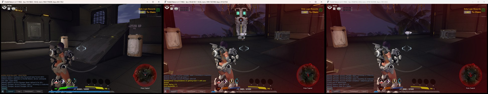

  

<h3 align="center">Firefall is back. Play it alone, or with your Steam friends.</h3>

  
  
  

---

**Firefall Reborn** is a fan-made revival of *Firefall*, the free-to-play open-world shooter by Red 5 Studios whose servers
shut down in 2017. It plugs into your own Steam copy of the game, edits the game files directly (no overlays), and runs the
whole world on your PC, so the game starts again and keeps working.

> **Release date: TBA.** Nothing is available to download yet. This page follows the build as it happens.

## What you will get

- **One click to play.** Press Play in Steam. The game starts its own local server in the background and shuts it down when you quit.
- **Single Player.** The whole game scaled so one person can beat it. No PvP.
- **Host a World / Join a Friend.** Invite Steam friends and play together, with no router setup. Multiplayer is harder and has PvP.
- **Everything Firefall had, rebuilt:** the campaign, hundreds of missions and world events, the original creatures, bosses and NPCs,
  operations, raids and dungeons, crafting, thumpers, vehicles, battleframes and abilities.
- **Steam achievements that really unlock.** All 117 of them.
- **A free in-game currency.** The old premium store comes back, paid for with Red Beans you **earn by playing**. No real money, ever.
- **One installer.** It finds your Firefall folder, installs everything and keeps itself updated.
- **A modern look (later).** Upscaled textures, a refreshed UI and modern render settings, so it looks like it was made today.

## Latest from the build

<!--SHOTS-->

  
  
  
  

**AI and encounters finished: repulsor, race, and the world part of our server** - *2026-11-17 19:05 (UTC+0)*

Done: AI and encounters (rewrite of the first creature AI), NPCs, missions _(started 2026-11-17 15:24 (UTC+0))_

---

**Carrying things, and missions** - *2026-11-17 18:54 (UTC+0)*

Two more parts of the world for our own server.

Carrying things: thumper parts, resonators, canisters, datapads and the rest of the game's carryable objects can now lie in the world. Walk up, press E and you pick it up; the game's own 'carrying' effect goes on you (a red resonator glows next to you). Press E again to put it down, and if you go down you drop it. Tested with a Red Resonator (screenshot).

Missions: a first mission system. A mission is a list of steps: go to a place, kill a number of a creature, or carry something from one place to another. The current step gets a waypoint marker, progress shows in chat, and finishing pays out XP (the game shows its own 'Mission Reward' pop-up) plus items. Two example missions for Coral Forest:
- Beach sweep: go down to the beach, kill three Aranha Workers, report back at the outpost. Tested in game: kills counted 1/3, 2/3, 3/3, then +6000 XP Mission Reward and 250 Crystite (screenshot).
- Lost resonator: a resonator lies near the Culex swarm, carry it back to the outpost.
For now you start one with !mission list and !mission start <number>.

Honest notes: these are our own missions, written in a simple file so more are easy to add. The game's 563 original missions had their logic on Red 5's servers, and the game's mission window uses messages nobody has documented yet, so it isn't used yet. Hooking up that window and bringing the real missions back is Phase 4 work. The waypoint marker is wired to the game's own mission marker, but I haven't seen it on screen yet.

Next in Phase 7: two more world events (melding repulsor, race), then animations part 2. Release TBA, nothing to download yet.

  

  

---

**Thumpers are back** - *2026-11-17 15:44 (UTC+0)*

The first encounter runs on our own server: the thumper, Firefall's signature activity.

How it works: call a thumper down and it lands in front of you and starts digging for 90 seconds. Every 20 seconds a wave of the zone's creatures comes at it: Aranhas, Skivers and Culex, two creatures in the first wave and one more each wave. Chat shows how full it is (25%, 50%, 75%). Defend it until it's done and everyone within 60 m gets the haul: Crystite and Sifted Earth, more for each wave survived. If nobody is left standing near it for 15 seconds, it gives up and lifts off empty.

Tested in game (screenshots): an Accord Thumper standing on the platform, with an auto-turret beside it for backup. Five waves came, the turret and I fought them off (I went down once and got back up), and it finished with 650 Crystite and 45 Sifted Earth in the inventory. The kills along the way took my character from level 10 to 11.

Honest notes: the original thumper rules were on Red 5's servers and are lost, so the timing, waves and haul are our own design built from the game's real pieces, and easy to tune. Creatures go for the players for now, not the thumper itself, and there's no thumper progress window yet (the status is in chat). For now you start one with !thump. Calling one in from an item comes later.

Underneath it's a general encounter system, so the next world events (the melding repulsor, races) plug into the same frame. Release TBA, nothing to download yet.

  ![The first encounter runs on our own server: the thumper, Firefall's signature activity.

How it works: call a thumper down and it lands in front of you and starts digging for 90 seconds. Every 20 seconds a wave of the zone's creatures comes at it: Aranhas, Skivers and Culex, two creatures in the first wave and one more each wave. Chat shows how full it is (25%, 50%, 75%). Defend it until it's done and everyone within 60 m gets the haul: Crystite and Sifted Earth, more for each wave survived. If nobody is left standing near it for 15 seconds, it gives up and lifts off empty.

Tested in game (screenshots): an Accord Thumper standing on the platform, with an auto-turret beside it for backup. Five waves came, the turret and I fought them off (I went down once and got back up), and it finished with 650 Crystite and 45 Sifted Earth in the inventory. The kills along the way took my character from level 10 to 11.

Honest notes: the original thumper rules were on Red 5's servers and are lost, so the timing, waves and haul are our own design built from the game's real pieces, and easy to tune. Creatures go for the players for now, not the thumper itself, and there's no thumper progress window yet (the status is in chat). For now you start one with !thump. Calling one in from an item comes later.

Underneath it's a general encounter system, so the next world events (the melding repulsor, races) plug into the same frame. Release TBA, nothing to download yet.](images/progress/2026-11-17_154456_1.jpg)
<!--/SHOTS-->

Newer screenshots are added here as the project moves along; the full history is in [CHANGELOG.md](CHANGELOG.md).

## Screenshots

  
  

  
  

Work in progress, running the real game against the local server.

## Progress

<!--PROGRESS-->
**Overall: `████░░░░░░░░░░░░░░░░` 22%** (28 of 136 roadmap items done) - last update 2026-11-17 19:12 (UTC+0)

| Phase | Progress | Done |
|---|---|---|
| Phase 0 - Make it run (DONE) | `████████████` 100% | 7/7 |
| Phase 1 - Launcher and install (next) | `████████████` 100% | 10/10 |
| Phase 2 - Steam: achievements, friends, invites | `██░░░░░░░░░░` 14% | 0/11 |
| Phase 3 - The game itself (server side, from the game's own data) | `░░░░░░░░░░░░` 0% | 0/38 |
| Phase 4 - Single player vs multiplayer | `░░░░░░░░░░░░` 0% | 0/7 |
| Phase 5 - Polish and what the deep search found missing | `█░░░░░░░░░░░` 10% | 1/10 |
| Phase 6 - Modernisation: make it look and feel like it was made today | `░░░░░░░░░░░░` 0% | 0/33 |
| Phase 7 - Our own server (replace PIN) - decided 2026-10-20 | `████████████` 100% | 10/10 |
| Phase 8 - Dedicated servers and a server browser (owner 2026-10-29) | `░░░░░░░░░░░░` 0% | 0/10 |
<!--/PROGRESS-->

The full plan, with every system listed, is in **[ROADMAP.md](ROADMAP.md)**. Each time something on it is finished it is ticked
off with the date and time, logged in **[CHANGELOG.md](CHANGELOG.md)** and announced on **[Discord](https://discord.gg/xNs7GknyBD)**.

## How it works (short version)

Firefall's servers are gone, but the game client and all its data are still on your disk. Reborn runs the server pieces locally:
a small database, a login/character server and a game server speaking the original network protocol. A launcher replaces the
game's start file so Steam starts everything in order. A few bytes in the game executable and some of the game's UI and text files
are patched, with a backup of every original, so the menu, branding and server address are ours.

## What you need

- Windows 10 or 11
- **Your own copy of Firefall on Steam** (it is still in your library if you owned it). Reborn does not include or distribute any
  game files.
- A PC that could run Firefall in 2014 (it is a 32-bit game)

## FAQ

**Is it playable now?** You can log in, make a character and walk around the world. Combat, enemies, missions and the rest are being
rebuilt step by step, in the order on the roadmap.

**Will it be free?** Yes.

**Will there be a download?** Yes, as a single installer, on this repository's Releases page. The date is not set (TBA) and nothing
is published until it is ready.

**Is it legal?** It is an unofficial fan project, not affiliated with or endorsed by Red 5 Studios or anyone who owns Firefall.
It contains none of the game's files and needs your own copy. Firefall and all related names and art belong to their owners.

**Why Steam?** Friends join through Steam, and achievements are unlocked through your Steam account.

## Built on the shoulders of

The community work that made a revival possible, with thanks:
**[The Melding Wars](https://github.com/themeldingwars)** (protocol research and server emulation: PIN, RIN.WebAPI, AeroMessages,
FauFau, SDBrowser) and everyone who documented the game's formats and network protocol. Special thanks to **DarkCisum**
for the full-detail texture levels (static.vtex0-2) the Steam install is missing.

## Follow along

- Roadmap: [ROADMAP.md](ROADMAP.md)
- Progress log: [CHANGELOG.md](CHANGELOG.md)
- **Discord: [discord.gg/xNs7GknyBD](https://discord.gg/xNs7GknyBD)** - updates, screenshots and gameplay videos as they happen, general chat and bug reports

Firefall Reborn is a fan project. Release date: TBA.

