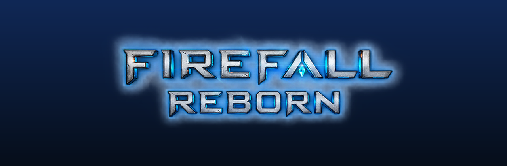
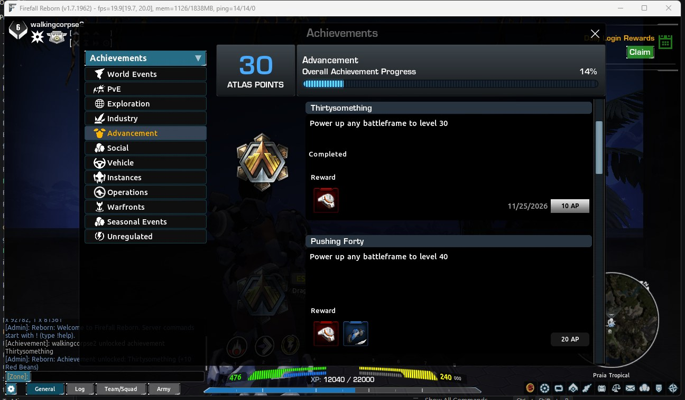
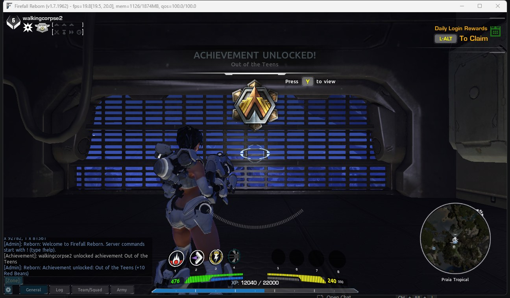
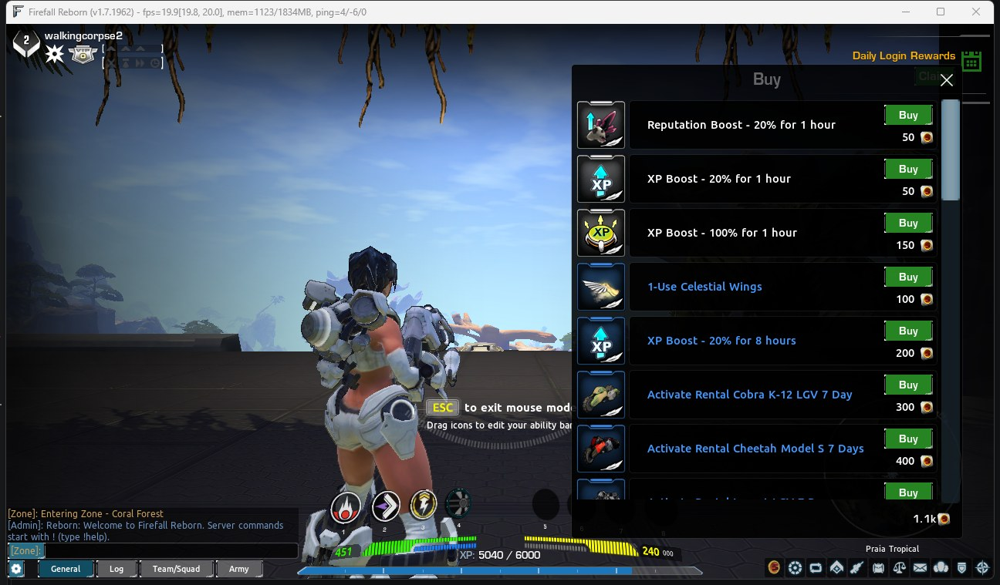
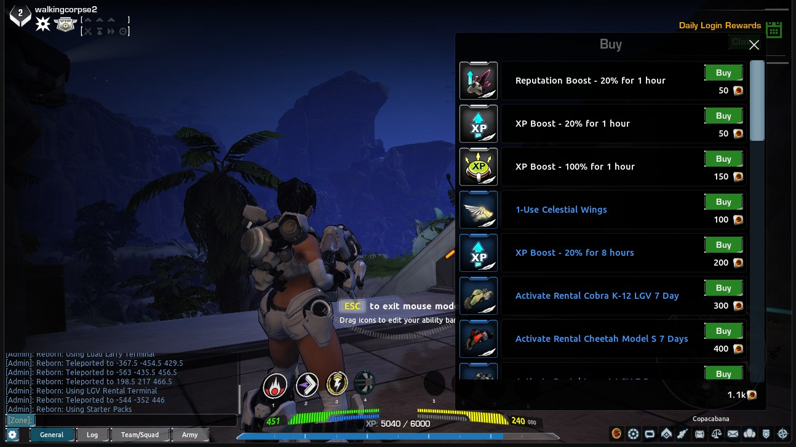

  

<h3 align="center">Firefall is back. Play it alone, or with your Steam friends.</h3>

  
  
  

---

**Firefall Reborn** is a fan-made revival of *Firefall*, the free-to-play open-world shooter by Red 5 Studios whose servers
shut down in 2017. It plugs into your own Steam copy of the game, edits the game files directly (no overlays), and runs the
whole world on your PC, so the game starts again and keeps working.

> **Release date: TBA.** Nothing is available to download yet. This page follows the build as it happens.

## What you will get

- **One click to play.** Press Play in Steam. The game starts its own local server in the background and shuts it down when you quit.
- **Single Player.** The whole game scaled so one person can beat it. No PvP.
- **Host a World / Join a Friend.** Invite Steam friends and play together, with no router setup. Multiplayer is harder and has PvP.
- **Everything Firefall had, rebuilt:** the campaign, hundreds of missions and world events, the original creatures, bosses and NPCs,
  operations, raids and dungeons, crafting, thumpers, vehicles, battleframes and abilities.
- **Achievements are back.** All of the game's achievements (the 117 Steam ones included) in the in-game Atlas Records panel, with the game's own unlock banner, each paying its Atlas Points in Red Beans. Steam itself only accepts unlocks from Red 5's servers, so they are not synced to Steam.
- **A free in-game currency.** The old premium store comes back, paid for with Red Beans you **earn by playing**. No real money, ever.
- **One installer.** It finds your Firefall folder, installs everything and keeps itself updated.
- **A modern look (later).** Upscaled textures, a refreshed UI and modern render settings, so it looks like it was made today.

## Latest from the build

<!--SHOTS-->

  
  
  
  

**Achievements work again, inside the game itself.** - *2026-11-25 15:54 (UTC+0)*

Started: Achievements must work. The client never calls Steam stats (Red 5's servers unlocked them), so our own process

---

**The red bean icon in the bottom-right corner of the HUD now opens the Red Bean Store wherever you are.** - *2026-11-25 15:13 (UTC+0)*

Done: HUD store button (red bean icon) opens the Red Bean Store in the game's own shop panel, anywhere (replaces the old web store pages)

---

**The shops in New Eden, taken in the game today: Luau Larry (luau thumpers, Cobra LGV, fireworks), Supply Officer Cross in Copacabana (thu...** - *2026-11-25 09:46 (UTC+0)*

The shops in New Eden, taken in the game today: Luau Larry (luau thumpers, Cobra LGV, fireworks), Supply Officer Cross in Copacabana (thumpers, glider and jump pads, Mobile Battleframe Station), the Accord Quartermaster (Ranger Supplies, Accord Supply Cache, Squad Thumper III, Emergency Glider), an LGV Rental Terminal (1-use LGVs, Locust Chopper, 1-day rentals) - all priced in Credits - and the Red Bean Store at the Starter Packs kiosks, priced in Red Beans (shown as Red Bean Reward Tokens; RB is earned by playing, 100 a day for logging in for now).
<!--/SHOTS-->

Newer screenshots are added here as the project moves along; the full history is in [CHANGELOG.md](CHANGELOG.md).

## Screenshots

  
  

  
  

Work in progress, running the real game against the local server.

## Progress

<!--PROGRESS-->
**Overall: `███████░░░░░░░░░░░░░` 36%** (35 of 142 roadmap items done) - last update 2026-11-26 02:47 (UTC+0)

| Phase | Progress | Done |
|---|---|---|
| Phase 0 - Make it run (DONE) | `████████████` 100% | 7/7 |
| Phase 1 - Launcher and install (DONE) | `████████████` 100% | 10/10 |
| Phase 2 - Steam: achievements, friends, invites | `███████░░░░░` 58% | 3/12 |
| Phase 3 - The game itself (server side, from the game's own data) | `████░░░░░░░░` 35% | 4/40 |
| Phase 4 - Single player vs multiplayer | `█░░░░░░░░░░░` 7% | 0/7 |
| Phase 5 - Polish and what the deep search found missing | `██░░░░░░░░░░` 18% | 1/11 |
| Phase 6 - Modernisation: make it look and feel like it was made today | `░░░░░░░░░░░░` 0% | 0/33 |
| Phase 7 - Our own server (replace PIN) - decided 2026-10-20 (DONE) | `████████████` 100% | 10/10 |
| Phase 8 - Dedicated servers and a server browser (owner 2026-10-29) | `░░░░░░░░░░░░` 0% | 0/12 |
<!--/PROGRESS-->

The full plan, with every system listed, is in **[ROADMAP.md](ROADMAP.md)**. Each time something on it is finished it is ticked
off with the date and time, logged in **[CHANGELOG.md](CHANGELOG.md)** and announced on **[Discord](https://discord.gg/xNs7GknyBD)**.

## How it works (short version)

Firefall's servers are gone, but the game client and all its data are still on your disk. Reborn runs the server pieces locally:
a small database, a login/character server and a game server speaking the original network protocol. A launcher replaces the
game's start file so Steam starts everything in order. A few bytes in the game executable and some of the game's UI and text files
are patched, with a backup of every original, so the menu, branding and server address are ours.

## What you need

- Windows 10 or 11
- **Your own copy of Firefall on Steam** (it is still in your library if you owned it). Reborn does not include or distribute any
  game files.
- A PC that could run Firefall in 2014 (it is a 32-bit game)

## FAQ

**Is it playable now?** You can log in, make a character and walk around the world. Combat, enemies, missions and the rest are being
rebuilt step by step, in the order on the roadmap.

**Will it be free?** Yes.

**Will there be a download?** Yes, as a single installer, on this repository's Releases page. The date is not set (TBA) and nothing
is published until it is ready.

**Is it legal?** It is an unofficial fan project, not affiliated with or endorsed by Red 5 Studios or anyone who owns Firefall.
It contains none of the game's files and needs your own copy. Firefall and all related names and art belong to their owners.

**Why Steam?** Friends join through Steam, and achievements are unlocked through your Steam account.

## Built on the shoulders of

The community work that made a revival possible, with thanks:
**[The Melding Wars](https://github.com/themeldingwars)** (protocol research and server emulation: PIN, RIN.WebAPI, AeroMessages,
FauFau, SDBrowser) and everyone who documented the game's formats and network protocol. Special thanks to **DarkCisum**
for the full-detail texture levels (static.vtex0-2) the Steam install is missing.

## Follow along

- Roadmap: [ROADMAP.md](ROADMAP.md)
- Progress log: [CHANGELOG.md](CHANGELOG.md)
- **Discord: [discord.gg/xNs7GknyBD](https://discord.gg/xNs7GknyBD)** - updates, screenshots and gameplay videos as they happen, general chat and bug reports

Firefall Reborn is a fan project. Release date: TBA.

