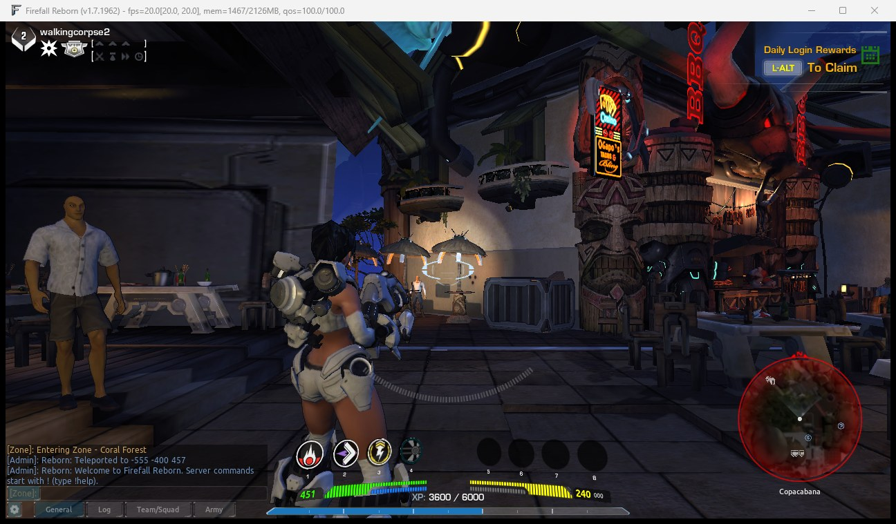
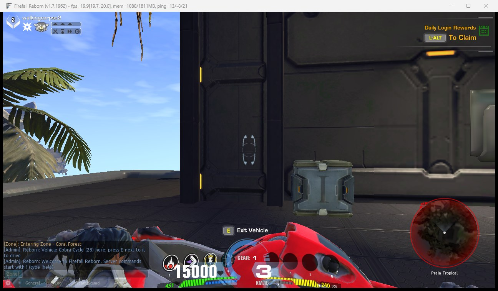
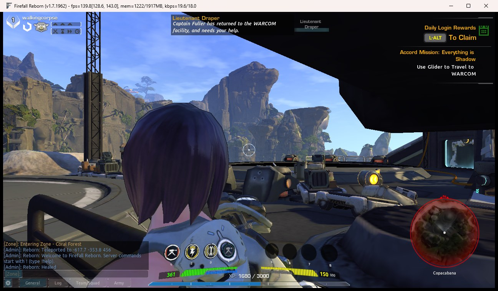

  

<h3 align="center">Firefall is back. Play it alone, or with your Steam friends.</h3>

  
  
  

---

**Firefall Reborn** is a fan-made revival of *Firefall*, the free-to-play open-world shooter by Red 5 Studios whose servers
shut down in 2017. It plugs into your own Steam copy of the game, edits the game files directly (no overlays), and runs the
whole world on your PC, so the game starts again and keeps working.

> **Release date: TBA.** Nothing is available to download yet. This page follows the build as it happens.

## What you will get

- **One click to play.** Press Play in Steam. The game starts its own local server in the background and shuts it down when you quit.
- **Single Player.** The whole game scaled so one person can beat it. No PvP.
- **Host a World / Join a Friend.** Invite Steam friends and play together, with no router setup. Multiplayer is harder and has PvP.
- **Everything Firefall had, rebuilt:** the campaign, hundreds of missions and world events, the original creatures, bosses and NPCs,
  operations, raids and dungeons, crafting, thumpers, vehicles, battleframes and abilities.
- **Steam achievements that really unlock.** All 117 of them.
- **A free in-game currency.** The old premium store comes back, paid for with Red Beans you **earn by playing**. No real money, ever.
- **One installer.** It finds your Firefall folder, installs everything and keeps itself updated.
- **A modern look (later).** Upscaled textures, a refreshed UI and modern render settings, so it looks like it was made today.

## Latest from the build

<!--SHOTS-->

  
  
  
  

**New Eden's towns are populated again.** - *2026-11-18 23:57 (UTC+0)*

Started: All NPCs: 453 town/story characters (vendors, quest givers, ambient wanderers, guards) with interactions

---

**Bikes: E now gets you in** - *2026-11-18 23:07 (UTC+0)*

Vehicles: pressing E next to a bike now gets you in. Found in a playtest: after !vehicle 28 the Cobra Cycle stood there but E did nothing. Cause: when you look at something, the game asks the server what you can do with it, and the server never answered for vehicles, so no prompt appeared and E was ignored. Now an empty vehicle within 5 m answers with the 'get in' interaction: the bike gets the highlight outline, and E puts you in the driver seat with the vehicle HUD (speed, gear) and the driving tips (W/S accelerate/reverse, A/D steer, Space brake). Tested with !vehicle 28 on the test client (seat + HUD confirmed); the real E key press still needs a check in normal play. Still being worked on: the world map is black unless zoomed all the way out to the globe - found where the game draws it, fix in progress. Release date still TBA, nothing to download yet.

---

**Story Mission 1 starts: talk to Lieutenant Draper** - *2026-11-18 16:31 (UTC+0)*

The first step of the story campaign works.

Lieutenant Draper is back in Copacabana, standing where he stood on the live servers (taken from the recording). Walk up to him, look at him and press E to talk. He gives his original voiced briefing, with his portrait and subtitles ('Captain Fuller has returned to the WARCOM facility, and needs your help.'), and Accord Mission: Everything is Shadow starts in your mission tracker with the next objective, 'Use Glider to Travel to WARCOM'.

The objective texts are the game's own, read from its mission data.

Not there yet: mission progress isn't saved between sessions, and the next part (gliding to WARCOM and the mission inside) is what we're rebuilding next. Release TBA, nothing to download yet.
<!--/SHOTS-->

Newer screenshots are added here as the project moves along; the full history is in [CHANGELOG.md](CHANGELOG.md).

## Screenshots

  
  

  
  

Work in progress, running the real game against the local server.

## Progress

<!--PROGRESS-->
**Overall: `██████░░░░░░░░░░░░░░` 28%** (34 of 139 roadmap items done) - last update 2026-11-25 09:04 (UTC+0)

| Phase | Progress | Done |
|---|---|---|
| Phase 0 - Make it run (DONE) | `████████████` 100% | 7/7 |
| Phase 1 - Launcher and install (next) | `████████████` 100% | 10/10 |
| Phase 2 - Steam: achievements, friends, invites | `████░░░░░░░░` 32% | 2/11 |
| Phase 3 - The game itself (server side, from the game's own data) | `██░░░░░░░░░░` 20% | 4/38 |
| Phase 4 - Single player vs multiplayer | `░░░░░░░░░░░░` 0% | 0/7 |
| Phase 5 - Polish and what the deep search found missing | `█░░░░░░░░░░░` 9% | 1/11 |
| Phase 6 - Modernisation: make it look and feel like it was made today | `░░░░░░░░░░░░` 0% | 0/33 |
| Phase 7 - Our own server (replace PIN) - decided 2026-10-20 | `████████████` 100% | 10/10 |
| Phase 8 - Dedicated servers and a server browser (owner 2026-10-29) | `░░░░░░░░░░░░` 0% | 0/12 |
<!--/PROGRESS-->

The full plan, with every system listed, is in **[ROADMAP.md](ROADMAP.md)**. Each time something on it is finished it is ticked
off with the date and time, logged in **[CHANGELOG.md](CHANGELOG.md)** and announced on **[Discord](https://discord.gg/xNs7GknyBD)**.

## How it works (short version)

Firefall's servers are gone, but the game client and all its data are still on your disk. Reborn runs the server pieces locally:
a small database, a login/character server and a game server speaking the original network protocol. A launcher replaces the
game's start file so Steam starts everything in order. A few bytes in the game executable and some of the game's UI and text files
are patched, with a backup of every original, so the menu, branding and server address are ours.

## What you need

- Windows 10 or 11
- **Your own copy of Firefall on Steam** (it is still in your library if you owned it). Reborn does not include or distribute any
  game files.
- A PC that could run Firefall in 2014 (it is a 32-bit game)

## FAQ

**Is it playable now?** You can log in, make a character and walk around the world. Combat, enemies, missions and the rest are being
rebuilt step by step, in the order on the roadmap.

**Will it be free?** Yes.

**Will there be a download?** Yes, as a single installer, on this repository's Releases page. The date is not set (TBA) and nothing
is published until it is ready.

**Is it legal?** It is an unofficial fan project, not affiliated with or endorsed by Red 5 Studios or anyone who owns Firefall.
It contains none of the game's files and needs your own copy. Firefall and all related names and art belong to their owners.

**Why Steam?** Friends join through Steam, and achievements are unlocked through your Steam account.

## Built on the shoulders of

The community work that made a revival possible, with thanks:
**[The Melding Wars](https://github.com/themeldingwars)** (protocol research and server emulation: PIN, RIN.WebAPI, AeroMessages,
FauFau, SDBrowser) and everyone who documented the game's formats and network protocol. Special thanks to **DarkCisum**
for the full-detail texture levels (static.vtex0-2) the Steam install is missing.

## Follow along

- Roadmap: [ROADMAP.md](ROADMAP.md)
- Progress log: [CHANGELOG.md](CHANGELOG.md)
- **Discord: [discord.gg/xNs7GknyBD](https://discord.gg/xNs7GknyBD)** - updates, screenshots and gameplay videos as they happen, general chat and bug reports

Firefall Reborn is a fan project. Release date: TBA.

